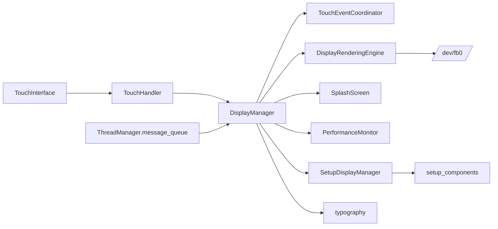

# Domain Design: Display

Created: 2025-12-29

## Table of Contents

- [1.0 Document Information](#10-document-information)
- [2.0 Domain Overview](#20-domain-overview)
- [3.0 Domain Boundaries](#30-domain-boundaries)
- [4.0 Components without a Tier 3 Document](#40-components-without-a-tier-3-document)
- [5.0 Interfaces](#50-interfaces)
- [6.0 Error Handling](#60-error-handling)
- [7.0 Visual Documentation](#70-visual-documentation)
- [8.0 Tier 3 Component Documents](#80-tier-3-component-documents)
- [Version History](#version-history)

---

## 1.0 Document Information

```yaml
document_info:
  document_id: "design-2c6b8e4d-domain_display"
  tier: 2
  domain: "Display"
  parent: "design-gtach-master.md"
  source_path: "src/gtach/display/"
  version: "2.0"
  date: "2026-11-13"
  author: "William Watson"
  status: "Implemented"
```

- **Master design:** [design-gtach-master.md](design-gtach-master.md)

[Return to Table of Contents](#table-of-contents)

---

## 2.0 Domain Overview

The Display domain draws every screen of GTach on the 480×480 round panel and handles touch input.

Responsibilities:

1. Frame loop, screens and link-state presentation (`DisplayManager`).
2. Framebuffer output (`DisplayRenderingEngine`).
3. Touch input: hardware abstraction, gesture classification, button regions.
4. Setup mode: discovery, device list, pairing and verification screens (`SetupDisplayManager` and `setup_components/`).
5. Fonts and text sizes (`typography.py`), palettes and display models (`models.py`).
6. Start-up splash screen and frame timing statistics.

Domain patterns:

- **One display thread** draws; touch callbacks arrive on the touch thread and act through `DisplayManager` methods and lock-guarded registries.
- **Framebuffer rendering:** pygame with `SDL_VIDEODRIVER=dummy`, frames written to `/dev/fb0`.
- **Derived conditions:** DISCONNECTED, Engine off and setup are not display modes; they are evaluated per frame.
- **Fail towards the safe screen:** an unknown link state shows DISCONNECTED; missing Engine off evidence shows DISCONNECTED.
- **Measured geometry:** layout coordinates and font sizes are constants established by measurement on the device.

[Return to Table of Contents](#table-of-contents)

---

## 3.0 Domain Boundaries

| Module | Content | Design |
|---|---|---|
| `manager.py` | `DisplayManager`, `gauge_full_scale()` | [design-b8c9d0e1](design-b8c9d0e1-component_display_manager.md) |
| `rendering/` | `DisplayRenderingEngine`, `RenderTarget`, `RenderingStats`, interface | [design-c9d0e1f2](design-c9d0e1f2-component_display_rendering_engine.md) |
| `input/` | `TouchEventCoordinator`, `TouchAction`, `TouchRegion`, interface | [design-d0e1f2a3](design-d0e1f2a3-component_display_touch_coordinator.md) |
| `splash.py`, `graphics/` | `SplashScreen`, splash graphics | [design-f2a3b4c5](design-f2a3b4c5-component_display_splash_screen.md) |
| `setup.py`, `setup_components/`, `setup_models.py`, `async_operations.py` | Setup mode | [design-a3b4c5d6](design-a3b4c5d6-component_display_setup_manager.md) |
| `touch.py` | `TouchHandler` (gesture classification) | design-b8c9d0e1 §6.0 |
| `touch_interface.py` | `TouchInterface`, `HyperPixelTouchInterface`, `MockTouchInterface`, `create_touch_interface()` | this document, §4.1 |
| `performance/` | `PerformanceMonitor`, `PerformanceMetrics` | this document, §4.2 |
| `typography.py` | `FontManager`, `TypographyConstants`, font accessors | this document, §4.3 |
| `models.py` | `DisplayMode`, `DisplayConfig`, `RPMBands`, `Palette`, `DAY_PALETTE`, `NIGHT_PALETTE`, `ConnectionStatus` | this document, §4.4 |

External dependencies: pygame; psutil (memory figure of the performance monitor); `hyperpixel2r` and `RPi.GPIO` (touch on the Pi, conditional imports); the Michroma font packaged in `gtach/assets/fonts/`.

Domain dependencies: Core (`ThreadManager`), Utilities (`ConfigStore`, `load_engine_profile`, `AcknowledgementStateManager`, updater, `TerminalRestorer`), Communication (device store for Clear settings; pairing through the setup interface).

[Return to Table of Contents](#table-of-contents)

---

## 4.0 Components without a Tier 3 Document

### 4.1 Touch interface

`create_touch_interface()` returns one shared `TouchInterface`. On a Raspberry Pi with `hyperpixel2r` installed it is `HyperPixelTouchInterface`, which receives touch events from the panel's controller; otherwise it is `MockTouchInterface`, which produces no events. A `TouchInterface` delivers `TouchEvent(event_type, x, y, timestamp)` with normalised coordinates to one registered callback (`TouchHandler._handle_touch_event`).

### 4.2 PerformanceMonitor

Records the start and end of each frame and derives frames per second, frame time and render time; the memory figure comes from psutil. `should_log_periodic()` lets the display loop emit one INFO line per interval without building the metrics object every frame. The monitor observes only; it does not change the frame rate. (The former Tier 3 document `design-e1f2a3b4` is retired.)

### 4.3 Typography

`FontManager` loads the packaged Michroma font and caches fonts by size; `get_plain_font()` returns the SDL default font. Module functions (`get_label_small_font()`, `get_title_display_font()`, `get_heading_font()`, ...) return the fonts for the named roles. `TypographyConstants` holds the font sizes, the button sizes, the 72 px minimum touch height, the 16 px minimum separation and the viewport radius of 238 px.

### 4.4 Models

- `DisplayMode`: `SPLASH`, `RADIAL`, `OPTIONS`, `ACKNOWLEDGEMENT`.
- `RPMBands`: `idle_max`, `torque_start`, `caution_start`, `warning_start`, `danger_start`, `redline_rpm`; validated in `__post_init__`; loaded from `assets/engine_profiles.yaml`.
- `Palette`: colours of the gauge (ground, track, tick, line, edge, label, six band colours and six centre colours); two instances, day and night.
- `DisplayConfig`: runtime display settings built from `AppConfig`.

[Return to Table of Contents](#table-of-contents)

---

## 5.0 Interfaces

| Counterpart | Contract |
|---|---|
| `GTachApplication` | Constructs `DisplayManager(thread_manager, terminal_restorer, config_store)`, injects the callbacks listed in design-b8c9d0e1 §3.2, calls `start()`, `set_setup_mode()`, `exit_setup_mode()`, `stop()` |
| Core | Registers the thread `display`; sends a heartbeat per frame; reads `message_queue` |
| Communication | Receives `OBDResponse` samples; reads link state, failure cause and silent-vehicle timestamp through callbacks |
| Utilities | `ConfigStore.load()` and `save()`; updater functions on a worker thread |

[Return to Table of Contents](#table-of-contents)

---

## 6.0 Error Handling

- A draw error is logged with traceback and affects one frame.
- A failed collaborator (touch, splash, performance monitor) is disabled; the display continues.
- Loggers: `DisplayManager`, `DisplayRenderingEngine`, `TouchHandler`, `TouchEventCoordinator`, `SplashScreen`, `SetupDisplayManager`.

[Return to Table of Contents](#table-of-contents)

---

## 7.0 Visual Documentation

Purpose: components of the domain. Legend: arrows show "uses".



[Return to Table of Contents](#table-of-contents)

---

## 8.0 Tier 3 Component Documents

- [design-b8c9d0e1-component_display_manager.md](design-b8c9d0e1-component_display_manager.md)
- [design-c9d0e1f2-component_display_rendering_engine.md](design-c9d0e1f2-component_display_rendering_engine.md)
- [design-d0e1f2a3-component_display_touch_coordinator.md](design-d0e1f2a3-component_display_touch_coordinator.md)
- [design-f2a3b4c5-component_display_splash_screen.md](design-f2a3b4c5-component_display_splash_screen.md)
- [design-a3b4c5d6-component_display_setup_manager.md](design-a3b4c5d6-component_display_setup_manager.md)

Retired (in `closed/`): `design-e1f2a3b4-component_display_performance_monitor` (see §4.2), `design-g1h2i3j4-gesture_reference` (see design-b8c9d0e1 §6.0).

[Return to Table of Contents](#table-of-contents)

---

## Version History

| Version | Date | Description |
|---|---|---|
| 1.0 | 2025-12-29 | Initial domain design document |
| 1.1 | 2025-12-29 | Added Tier 3 component document cross-references |
| 1.2 | 2026-03-13 | C3: fps_limit 60->30. C4: removed rpm_warning/rpm_danger; replaced with fixed 4-band background colour scheme and rpm_max. |
| 1.3 | 2026-05-27 | §8.2: added DISCONNECTED state and transitions (connection lost, connection restored, long-press to SETUP). |
| 1.4 | 2026-05-27 | §8.2: renamed SETTINGS → OPTIONS. |
| 2.0 | 2026-11-13 | Refreshed against the source: package layout (`rendering/`, `input/`, `performance/`, `setup_components/`), RADIAL-only display with derived conditions, touch interface, typography and models; retired documents recorded; links converted to GitHub slugs (proposal-f8d0064b WP4). |

---

Copyright (c) 2026 William Watson. MIT License.
