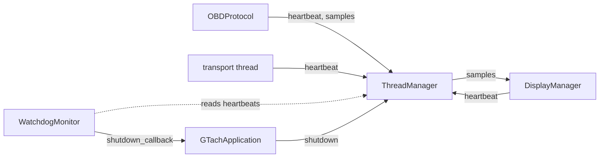

# Domain Design: Core

Created: 2025-12-29

## Table of Contents

- [1.0 Document Information](#10-document-information)
- [2.0 Domain Overview](#20-domain-overview)
- [3.0 Domain Boundaries](#30-domain-boundaries)
- [4.0 Components](#40-components)
- [5.0 Interfaces](#50-interfaces)
- [6.0 Error Handling](#60-error-handling)
- [7.0 Visual Documentation](#70-visual-documentation)
- [8.0 Tier 3 Component Documents](#80-tier-3-component-documents)
- [Version History](#version-history)

---

## 1.0 Document Information

```yaml
document_info:
  document_id: "design-4f8a2b1c-domain_core"
  tier: 2
  domain: "Core"
  parent: "design-gtach-master.md"
  source_path: "src/gtach/core/"
  version: "2.0"
  date: "2026-11-13"
  author: "William Watson"
  status: "Implemented"
```

- **Master design:** [design-gtach-master.md](design-gtach-master.md)

[Return to Table of Contents](#table-of-contents)

---

## 2.0 Domain Overview

The Core domain provides the thread infrastructure shared by all other domains.

Responsibilities:

1. Register application threads and track their status and heartbeat (`ThreadManager`).
2. Carry RPM samples from the Communication domain to the Display domain (`ThreadManager.message_queue`, `data_available`).
3. Stop threads within a time budget at shutdown.
4. Detect a stalled or exited thread and, for a critical thread, shut the application down so that systemd restarts it (`WatchdogMonitor`).

Domain patterns:

- **Standard-library threading only.** There is no asyncio event loop and no async/sync bridge.
- **Monotonic time** for every heartbeat and interval, so that a wall-clock step cannot cause a false stall (issue-b9ee7428).
- **No call-out under a lock:** stop functions, joins and recovery handlers run after the state lock is released.
- **Recovery by process restart:** no thread is restarted in process (issue-860fd5f7).

[Return to Table of Contents](#table-of-contents)

---

## 3.0 Domain Boundaries

| Module | Content |
|---|---|
| `core/thread.py` | `ThreadStatus`, `ThreadInfo`, `ThreadManager` |
| `core/watchdog.py` | `RecoveryLevel`, `RecoveryStats`, `ThreadHealth`, `WatchdogMonitor` |

`core/__init__.py` exports `ThreadManager`, `ThreadStatus`, `ThreadInfo` and `WatchdogMonitor`.

External dependencies: Python standard library only. Domain dependencies: `utils.waits.wait_for_event`; `comm.obd.OBDResponse` for type checking only.

[Return to Table of Contents](#table-of-contents)

---

## 4.0 Components

| Component | Design | Summary |
|---|---|---|
| `ThreadManager` | [design-a1b2c3d4](design-a1b2c3d4-component_core_thread_manager.md) | Thread registry, heartbeat, stop and shutdown, message queue |
| `WatchdogMonitor` | [design-b2c3d4e5](design-b2c3d4e5-component_core_watchdog_monitor.md) | Heartbeat supervision with escalating response |

Registered threads at runtime:

| Name | Owner | Watchdog class |
|---|---|---|
| `display` | `DisplayManager` | critical |
| `obd_protocol` | `OBDProtocol` | critical |
| `transport` | `GTachApplication` (runs `OBDTransport.reconnect_indefinitely`) | advisory (warnings only) |
| others (for example setup threads) | their creators | non-critical |

[Return to Table of Contents](#table-of-contents)

---

## 5.0 Interfaces

| Consumer | Contract |
|---|---|
| Any thread owner | `register_thread(name, thread, stop_func)`, then `update_heartbeat(name)` at least every 15 s |
| Communication | `message_queue.put_nowait(OBDResponse)`; `data_available.set()` |
| Display | `message_queue.get_nowait()` after `data_available` |
| Application | `WatchdogMonitor(thread_manager, shutdown_callback=...)`, `start()`, `stop()`; `ThreadManager.shutdown(timeout)` |

`message_queue` is a `queue.Queue` with capacity 5; the producer discards the oldest sample when it is full.

[Return to Table of Contents](#table-of-contents)

---

## 6.0 Error Handling

- A stop function that raises is logged with traceback; the join still proceeds.
- A thread that does not end within its timeout is marked `FAILED` and reported at WARNING.
- A failure of the graceful shutdown callback leads to `os._exit(1)` (emergency shutdown).
- Loggers: `ThreadManager`, `WatchdogMonitor`.

[Return to Table of Contents](#table-of-contents)

---

## 7.0 Visual Documentation

Purpose: the Core domain between its neighbours. Legend: solid arrows are calls, dashed arrows are observations.



[Return to Table of Contents](#table-of-contents)

---

## 8.0 Tier 3 Component Documents

- [design-a1b2c3d4-component_core_thread_manager.md](design-a1b2c3d4-component_core_thread_manager.md)
- [design-b2c3d4e5-component_core_watchdog_monitor.md](design-b2c3d4e5-component_core_watchdog_monitor.md)

Retired (in `closed/`): `design-c3d4e5f6-component_core_async_sync_bridge` (the component is not in the source).

[Return to Table of Contents](#table-of-contents)

---

## Version History

| Version | Date | Description |
|---|---|---|
| 1.0 | 2025-12-29 | Initial domain design document |
| 1.1 | 2025-12-29 | Added Tier 3 component document cross-references |
| 2.0 | 2026-11-13 | Refreshed against the source: asyncio bridge removed; monotonic heartbeats; critical and advisory threads; recovery by process restart; retired document recorded; links converted to GitHub slugs (proposal-f8d0064b WP4). |

---

Copyright (c) 2026 William Watson. MIT License.
