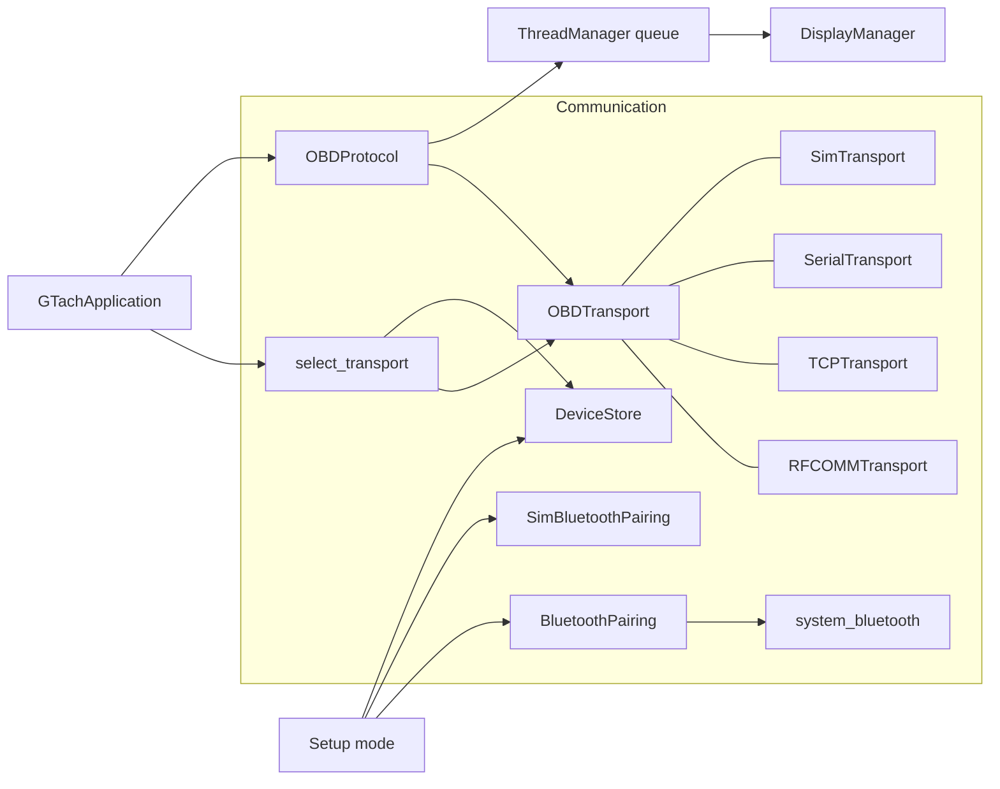
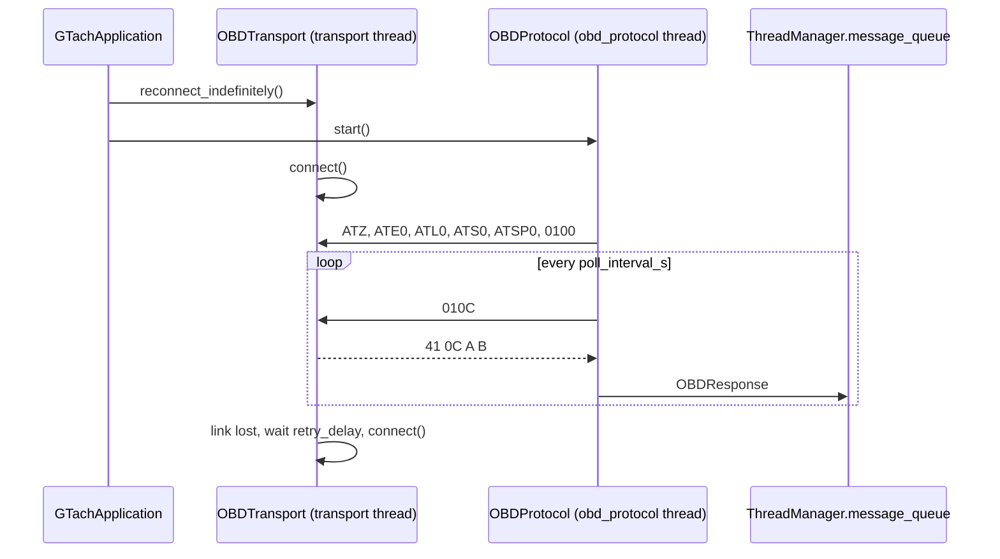

# Domain Design: Communication

Created: 2025-12-29

## Table of Contents

- [1.0 Document Information](#10-document-information)
- [2.0 Domain Overview](#20-domain-overview)
- [3.0 Domain Boundaries](#30-domain-boundaries)
- [4.0 Components](#40-components)
- [5.0 Interfaces](#50-interfaces)
- [6.0 Data Design](#60-data-design)
- [7.0 Error Handling](#70-error-handling)
- [8.0 Visual Documentation](#80-visual-documentation)
- [9.0 Tier 3 Component Documents](#90-tier-3-component-documents)
- [Version History](#version-history)

---

## 1.0 Document Information

```yaml
document_info:
  document_id: "design-7d3e9f5a-domain_comm"
  tier: 2
  domain: "Communication"
  parent: "design-gtach-master.md"
  source_path: "src/gtach/comm/"
  version: "3.0"
  date: "2026-11-13"
  author: "William Watson"
  status: "Implemented"
```

- **Master design:** [design-gtach-master.md](design-gtach-master.md)

[Return to Table of Contents](#table-of-contents)

---

## 2.0 Domain Overview

The Communication domain connects GTach to an ELM327 OBD-II adapter and delivers engine speed samples to the Display domain.

Responsibilities:

1. Transport abstraction: one connection skeleton (`OBDTransport`) with RFCOMM, TCP, serial and simulated implementations.
2. Link supervision: connect, detect a dead or closed link, reconnect indefinitely, and name the cause of each failure.
3. OBD protocol: adapter initialisation, RPM polling, and evidence of a silent vehicle.
4. Device persistence: the paired adapter in `devices.yaml`.
5. Discovery and pairing for setup mode, real and simulated.

Domain patterns:

- **Template method:** `OBDTransport` holds the skeleton; subclasses supply handle primitives.
- **Factory:** `select_transport()` chooses the transport from `--transport` or the platform.
- **Report, never act:** the domain names host faults (missing controller, wedged link) and never changes host state (issue-5e7a03c4).
- **Locks:** shared state is guarded by a lock; no call-out is made under a lock (CLAUDE.md rule 8).

[Return to Table of Contents](#table-of-contents)

---

## 3.0 Domain Boundaries

### 3.1 Modules

| Module | Content |
|---|---|
| `transport.py` | `OBDTransport`, `TransportState`, `TransportError` hierarchy, failure causes, `select_transport()`, transport name tuples |
| `rfcomm.py` | `RFCOMMTransport` (production, Classic Bluetooth SPP) |
| `tcp_transport.py` | `TCPTransport` (emulator, WiFi adapter) |
| `serial_transport.py` | `SerialTransport` (USB or UART, with port discovery) |
| `sim_transport.py` | `SimTransport` (synthetic RPM; `simtcp` and `simbt`) |
| `obd.py` | `OBDProtocol`, `OBDResponse` |
| `models.py` | `BluetoothDevice` (persisted model), `DiscoveredDevice` |
| `device_store.py` | `DeviceStore`, `get_device_store()` |
| `pairing.py` | `BluetoothPairing` (discovery, pairing, communication test) |
| `system_bluetooth.py` | `bluetoothctl`-based discovery and a standard-library RFCOMM `BluetoothSocket`; used when PyBluez is not installed |
| `sim_bluetooth.py` | `SimBluetoothPairing` (fake devices for `simbt`) |

### 3.2 External dependencies

| Dependency | Use |
|---|---|
| Python `socket` (`AF_BLUETOOTH`, `BTPROTO_RFCOMM`) | RFCOMM transport and pairing socket |
| pyserial | Serial transport |
| PyYAML | Device store |
| `bluetoothctl` (BlueZ) | Discovery through `system_bluetooth` |
| PyBluez (optional, not a declared dependency) | Used by `pairing.py` when importable |

### 3.3 Domain dependencies

- **Core:** `ThreadManager` (thread registration, heartbeat, `message_queue`, `data_available`).
- **Utilities:** `gtach_home()`, `PlatformType`, `wait_for_event`.
- **Display:** `pairing.py` and `sim_bluetooth.py` import the setup models (`BluetoothDevice`, `DeviceType`, `PairingStatus`) from `display.setup_models`. This is the one import from Communication into Display; `comm/models.py` avoids it with the `DiscoveredDevice` protocol.

[Return to Table of Contents](#table-of-contents)

---

## 4.0 Components

| Component | Design | Summary |
|---|---|---|
| `OBDTransport`, `select_transport()` | [design-b1c2d3e4](design-b1c2d3e4-component_comm_transport.md) | Connection skeleton, causes, factory |
| `RFCOMMTransport` | [design-c2d3e4f5](design-c2d3e4f5-component_comm_rfcomm_transport.md) | Bluetooth SPP socket |
| `TCPTransport` | [design-d3e4f5a6](design-d3e4f5a6-component_comm_tcp_transport.md) | TCP socket |
| `SerialTransport` | [design-e4f5a6b7](design-e4f5a6b7-component_comm_serial_transport.md) | pyserial port with discovery |
| `OBDProtocol` | [design-f5a6b7c8](design-f5a6b7c8-component_comm_obd_protocol.md) | Initialisation, polling, vehicle silent state |
| `DeviceStore` | [design-a6b7c8d9](design-a6b7c8d9-component_comm_device_store.md) | Persistence of paired devices |
| `BluetoothDevice` | [design-a7b8c9d0](design-a7b8c9d0-component_comm_bluetooth_device.md) | Persisted device model |

Components without a Tier 3 document:

- **`SimTransport`** overrides the whole `OBDTransport` skeleton. It answers the ELM327 initialisation commands and `010C` with a synthetic RPM sweep, and supports `drop_link()`. It serves both `simtcp` (forced, no setup) and `simbt` (through setup).
- **`BluetoothPairing`** runs discovery in chunks of `DISCOVERY_CHUNK_S` with progress and device callbacks, classifies devices by name (`DeviceType`), and pairs by opening an RFCOMM socket on channel 1 and testing ELM327 communication. All blocking operations are bounded by timeouts and can be cancelled. Its use from setup mode is described in [design-a3b4c5d6](design-a3b4c5d6-component_display_setup_manager.md).
- **`SimBluetoothPairing`** offers the same interface with four fake devices and a simulated pairing delay and failure rate.

[Return to Table of Contents](#table-of-contents)

---

## 5.0 Interfaces

### 5.1 Threads

| Thread (ThreadManager name) | Runs | Started by |
|---|---|---|
| `transport` | `OBDTransport.reconnect_indefinitely(retry_delay, heartbeat)` | `GTachApplication._start_obd` |
| `obd_protocol` | `OBDProtocol._protocol_loop` | `OBDProtocol.start()` |

### 5.2 Contracts with other domains

| Consumer | Contract |
|---|---|
| Display (`DisplayManager`) | Reads `OBDResponse` from `ThreadManager.message_queue` (capacity 5; oldest dropped when full) after `data_available` is set |
| Display (`DisplayManager`) | Reads `OBDTransport.last_failure_cause`, `is_connected()` and `retry_delay` for the DISCONNECTED screen, and `OBDProtocol.last_vehicle_silent_ts()` for "Engine off" |
| Display (setup) | Calls `BluetoothPairing` or `SimBluetoothPairing` through `BluetoothSetupInterface`; saves the paired device with `DeviceStore.save_device(BluetoothDevice.from_discovered(...))` |
| Application (`GTachApplication`) | Calls `select_transport()`, starts and stops the transport and the protocol |

[Return to Table of Contents](#table-of-contents)

---

## 6.0 Data Design

- **`OBDResponse`:** `pid`, `data` (two bytes), `timestamp`, `error`. RPM = `((A * 256) + B) / 4`.
- **`TransportState`:** `DISCONNECTED`, `CONNECTING`, `CONNECTED`, `ERROR`.
- **`BluetoothDevice`:** `name`, `mac_address`, `device_type`, `last_connected`.
- **`devices.yaml`:** `paired_devices.primary` and `paired_devices.secondary`, under `gtach_home()/config/`.
- **Failure causes:** short strings (40 characters or fewer) defined in `transport.py`.

[Return to Table of Contents](#table-of-contents)

---

## 7.0 Error Handling

- Transport I/O paths do not raise. They return `False` or `None`, record `last_failure_cause` and leave recovery to `reconnect_indefinitely()`.
- A dead peer is detected by five consecutive command timeouts; a closed peer by an EOF read.
- `select_transport()` raises `TransportError`; `GTachApplication` handles it by entering setup mode or reporting the failure.
- Unexpected exceptions are logged with `exc_info=True`. Expected link failures are logged without a traceback.
- Loggers: the concrete transport class name, `OBDProtocol`, `DeviceStore`, `BluetoothPairing`.

[Return to Table of Contents](#table-of-contents)

---

## 8.0 Visual Documentation

Purpose: components of the domain and their neighbours. Legend: arrows show "uses"; dashed boxes are other domains.



Purpose: start-up and steady state of the link. Legend: solid arrows are calls, dashed arrows are returns or data.



[Return to Table of Contents](#table-of-contents)

---

## 9.0 Tier 3 Component Documents

- [design-b1c2d3e4-component_comm_transport.md](design-b1c2d3e4-component_comm_transport.md)
- [design-c2d3e4f5-component_comm_rfcomm_transport.md](design-c2d3e4f5-component_comm_rfcomm_transport.md)
- [design-d3e4f5a6-component_comm_tcp_transport.md](design-d3e4f5a6-component_comm_tcp_transport.md)
- [design-e4f5a6b7-component_comm_serial_transport.md](design-e4f5a6b7-component_comm_serial_transport.md)
- [design-f5a6b7c8-component_comm_obd_protocol.md](design-f5a6b7c8-component_comm_obd_protocol.md)
- [design-a6b7c8d9-component_comm_device_store.md](design-a6b7c8d9-component_comm_device_store.md)
- [design-a7b8c9d0-component_comm_bluetooth_device.md](design-a7b8c9d0-component_comm_bluetooth_device.md)

Retired (in `closed/`): `design-d4e5f6a7-component_comm_bluetooth_manager` (replaced by the transport designs), `design-e5f6a7b8-component_comm_obd_protocol` (merged into `f5a6b7c8`), `design-f6a7b8c9-component_comm_device_store` (superseded by `a6b7c8d9`).

[Return to Table of Contents](#table-of-contents)

---

## Version History

| Version | Date | Description |
|---|---|---|
| 1.0 | 2025-12-29 | Initial domain design document |
| 1.1 | 2025-12-29 | Added Tier 3 component document cross-references |
| 2.0 | 2026-03-24 | Transport abstraction redesign: replaced BluetoothManager/Bleak with OBDTransport ABC and three concrete transports (RFCOMM, Serial, TCP); updated §4–§9 to reflect new architecture |
| 3.0 | 2026-11-13 | Refreshed against the source: module list including simulation, pairing and `system_bluetooth`; link supervision, failure causes and vehicle silent state; thread and inter-domain contracts; component detail moved to the Tier 3 documents; retired documents recorded; links converted to GitHub slugs (proposal-f8d0064b WP4). |

---

Copyright (c) 2026 William Watson. MIT License.
