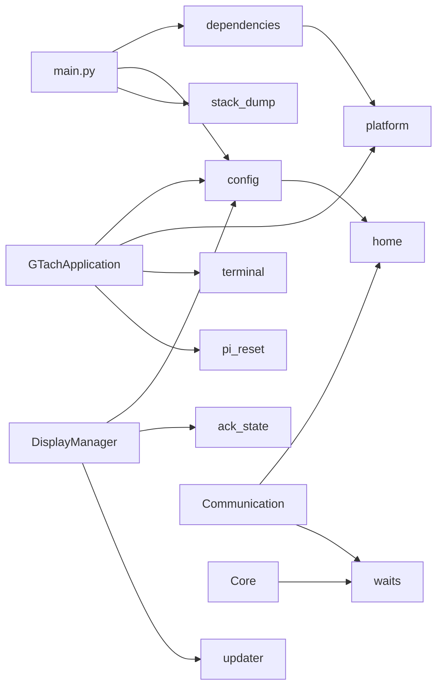

# Domain Design: Utilities

Created: 2025-12-29

## Table of Contents

- [1.0 Document Information](#10-document-information)
- [2.0 Domain Overview](#20-domain-overview)
- [3.0 Domain Boundaries](#30-domain-boundaries)
- [4.0 Components without a Tier 3 Document](#40-components-without-a-tier-3-document)
- [5.0 Interfaces](#50-interfaces)
- [6.0 Error Handling](#60-error-handling)
- [7.0 Visual Documentation](#70-visual-documentation)
- [8.0 Tier 3 Component Documents](#80-tier-3-component-documents)
- [Version History](#version-history)

---

## 1.0 Document Information

```yaml
document_info:
  document_id: "design-9a1f3c7e-domain_utils"
  tier: 2
  domain: "Utilities"
  parent: "design-gtach-master.md"
  source_path: "src/gtach/utils/"
  version: "2.1"
  date: "2026-11-13"
  author: "William Watson"
  status: "Implemented"
```

- **Master design:** [design-gtach-master.md](design-gtach-master.md)

[Return to Table of Contents](#table-of-contents)

---

## 2.0 Domain Overview

The Utilities domain holds services without display or communication logic: configuration, file locations, platform detection, dependency validation, and small host-facing helpers.

Domain patterns:

- **One home directory:** everything GTach reads or writes at runtime is located through `gtach_home()` (`$GTACH_HOME`, default `/opt/gtach`) (issue-5fbff586).
- **One configuration file:** `config.yaml` with a flat schema, owned by `ConfigStore`.
- **Never raise into the caller:** helpers that touch the host (`reboot_device`, the updater, platform detection) return a result and log; they do not propagate exceptions.
- **Conditional hardware imports:** `RPi.GPIO` is imported inside `try/except ImportError`.

[Return to Table of Contents](#table-of-contents)

---

## 3.0 Domain Boundaries

| Module | Content | Design |
|---|---|---|
| `home.py` | `gtach_home()`, `GTACH_HOME_ENV`, `DEFAULT_GTACH_HOME` | [design-f8a9b0c1](design-f8a9b0c1-component_utils_home.md) |
| `config.py` | `ConfigStore`, `AppConfig`, `SplashConfig`, `load_engine_profile()` | [design-b4c5d6e7](design-b4c5d6e7-component_utils_config_manager.md) |
| `platform.py` | `PlatformDetector`, `PlatformType`, `get_platform_type()` and related functions | [design-c5d6e7f8](design-c5d6e7f8-component_utils_platform_detector.md) |
| `dependencies.py` | `DependencyValidator`, `validate_dependencies()` | [design-e7f8a9b0](design-e7f8a9b0-component_utils_dependency_validator.md) |
| `terminal.py` | `TerminalRestorer` | [design-d6e7f8a9](design-d6e7f8a9-component_utils_terminal_restorer.md) |
| `waits.py` | `wait_for_event()` | this document, §4.1 |
| `ack_state.py` | `AcknowledgementStateManager` | this document, §4.2 |
| `updater.py` | Update discovery for the OPTIONS update screen | this document, §4.3 |
| `pi_reset.py` | `reboot_device()` | this document, §4.4 |
| `stack_dump.py` | SIGUSR1 all-thread stack dump | this document, §4.5 |

`utils/__init__.py` exports `ConfigStore`, `AppConfig`, `gtach_home`, `TerminalRestorer`, `DependencyValidator`, `validate_dependencies`, `get_platform_type` and `PlatformType`.

External dependencies: PyYAML; psutil is not used in this domain. Domain dependencies: `display.models.RPMBands` (imported lazily by `load_engine_profile` and for type checking by `ack_state`).

[Return to Table of Contents](#table-of-contents)

---

## 4.0 Components without a Tier 3 Document

### 4.1 wait_for_event

```python
def wait_for_event(event: threading.Event, timeout: float) -> bool
```

A timed wait on a `threading.Event` in slices of 0.1 s against a `time.monotonic()` deadline. `Event.wait(timeout)` can be extended by a backward wall-clock step on Python 3.9; this helper cannot (issue-4f671d09). Returns whether the event was set.

### 4.2 AcknowledgementStateManager

Persists the operator's acknowledgement of the RPM thresholds in a state file separate from `config.yaml`. The stored value is a hash of the thresholds and the engine profile identifier, so a change of either invalidates the acknowledgement.

```python
class AcknowledgementStateManager:
    def __init__(self, state_file_path: Optional[Path] = None): ...
    def is_acknowledged(self, rpm_bands: RPMBands, profile_id: str) -> bool: ...
    def set_acknowledged(self, rpm_bands: RPMBands, profile_id: str) -> bool: ...
    def clear(self) -> bool: ...
    def get_state_info(self) -> Optional[Dict[str, Any]]: ...
```

### 4.3 Updater

Filesystem logic for the OPTIONS update screen; no display dependency.

| Function | Purpose |
|---|---|
| `get_installed_version()` | Order key of the installed `gtach` version from `importlib.metadata` |
| `parse_wheel_version(filename)` | Order key of the version in a wheel file name |
| `validate_wheel(path)` | Whether the file is a complete, readable zip |
| `find_available_update()` | `(filename, version)` of the newest valid wheel in `/opt/gtach/updates` that is strictly newer than the installed version, or `None` |
| `stage_pending(filename)` | Writes `/opt/gtach/updates/.install-pending`, which `bin/gtach-preflight.sh` consumes at the next service start |

Versions are read in the normalised PEP 440 form `N(.N)*[{a,b,rc}N]`. The order key is the release padded to three components, followed by a phase rank (`a` −3, `b` −2, `rc` −1, final 0) and the pre-release number, so `1.0.0rc1` orders below `1.0.0` ([change-c41037ea](../change/closed/change-c41037ea-update-version-ordering.md)). Other forms are not recognised: an unrecognised installed version stops the check with a WARNING, and such a wheel is skipped.

### 4.4 reboot_device

```python
def reboot_device(timeout: float = 10.0) -> str
```

Runs the fixed command `/sbin/reboot` and returns an outcome string of 40 characters or fewer. It never raises. It blocks, so the caller runs it on a worker thread. The path is not configurable, so that no configured value reaches a command line.

### 4.5 Stack dump

`stack_dump.install()` registers a Python-level `SIGUSR1` handler that appends one dump of every Python thread to `stacks.log` (issue-1a8f40ea). It uses `sys._current_frames()`; `faulthandler`'s C-level dumps are not used, because they terminated the process on the Pi (issue-fe755cfd). The handler stays installed for the life of the process.

[Return to Table of Contents](#table-of-contents)

---

## 5.0 Interfaces

| Consumer | Uses |
|---|---|
| `main.py` | `validate_dependencies()`, `ConfigStore.validate()`, `gtach_home()`, `stack_dump` |
| `GTachApplication` | `ConfigStore`, `TerminalRestorer`, `get_platform_type()`, `gtach_home()`, `reboot_device()` |
| `DisplayManager` | `ConfigStore`, `load_engine_profile()`, `AcknowledgementStateManager`, updater functions |
| Communication | `gtach_home()`, `PlatformType`, `wait_for_event()` |
| Core | `wait_for_event()` |

[Return to Table of Contents](#table-of-contents)

---

## 6.0 Error Handling

- A missing or invalid `config.yaml` yields defaults; invalid values are replaced by their defaults with a WARNING; nothing is written on load.
- A missing `engine_profiles.yaml` or profile yields the default `RPMBands` with a WARNING.
- Host helpers return a result string or `None` and log unexpected exceptions with `exc_info=True`.

[Return to Table of Contents](#table-of-contents)

---

## 7.0 Visual Documentation

Purpose: the modules of the domain and their consumers. Legend: arrows show "uses".



[Return to Table of Contents](#table-of-contents)

---

## 8.0 Tier 3 Component Documents

- [design-b4c5d6e7-component_utils_config_manager.md](design-b4c5d6e7-component_utils_config_manager.md)
- [design-f8a9b0c1-component_utils_home.md](design-f8a9b0c1-component_utils_home.md)
- [design-c5d6e7f8-component_utils_platform_detector.md](design-c5d6e7f8-component_utils_platform_detector.md)
- [design-d6e7f8a9-component_utils_terminal_restorer.md](design-d6e7f8a9-component_utils_terminal_restorer.md)
- [design-e7f8a9b0-component_utils_dependency_validator.md](design-e7f8a9b0-component_utils_dependency_validator.md)

[Return to Table of Contents](#table-of-contents)

---

## Version History

| Version | Date | Description |
|---|---|---|
| 1.0 | 2025-12-29 | Initial domain design document |
| 1.1 | 2025-12-29 | Added Tier 3 component document cross-references |
| 1.2 | 2026-03-13 | C1: removed retry_limit attribute. C3: fps_limit 60->30. C4: removed rpm_warning/rpm_danger; added rpm_max. OOS-05: removed SessionConfig section from config structure. |
| 2.0 | 2026-11-13 | Refreshed against the source: module list with `home`, `waits`, `ack_state`, `updater`, `pi_reset` and `stack_dump`; single `config.yaml` under `gtach_home()`; links converted to GitHub slugs (proposal-f8d0064b WP4). |
| 2.1 | 2026-11-13 | §4.3: version order key with pre-release support ([change-c41037ea](../change/closed/change-c41037ea-update-version-ordering.md)). |

---

Copyright (c) 2026 William Watson. MIT License.
