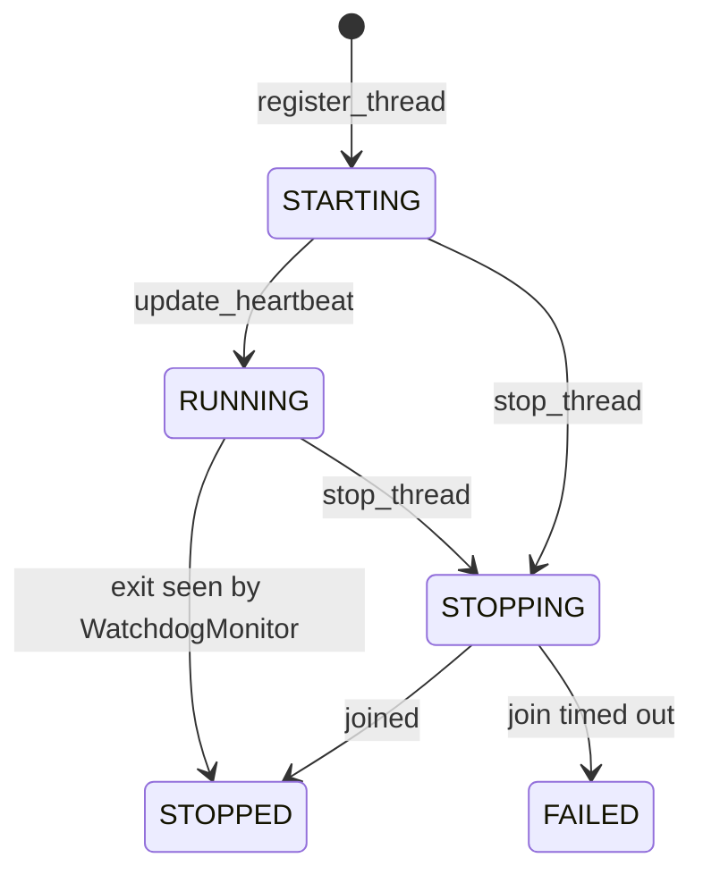

# Component Design: ThreadManager

Created: 2025-12-29

## Table of Contents

- [1.0 Document Information](#10-document-information)
- [2.0 Component Overview](#20-component-overview)
- [3.0 Elements](#30-elements)
- [4.0 Behaviour](#40-behaviour)
- [5.0 Error Handling](#50-error-handling)
- [6.0 Visual Documentation](#60-visual-documentation)
- [7.0 Related Documents](#70-related-documents)
- [Version History](#version-history)

---

## 1.0 Document Information

```yaml
document_info:
  document_id: "design-a1b2c3d4-component_core_thread_manager"
  tier: 3
  domain: "Core"
  component: "ThreadManager"
  parent: "design-4f8a2b1c-domain_core.md"
  source_file: "src/gtach/core/thread.py"
  version: "2.0"
  date: "2026-11-13"
  author: "William Watson"
  status: "Implemented"
```

- **Domain design:** [design-4f8a2b1c-domain_core.md](design-4f8a2b1c-domain_core.md)

[Return to Table of Contents](#table-of-contents)

---

## 2.0 Component Overview

`ThreadManager` is the registry of application threads. It records each thread's status and last heartbeat, stops threads individually or all together, and owns the bounded queue that carries RPM samples to the display.

[Return to Table of Contents](#table-of-contents)

---

## 3.0 Elements

### 3.1 ThreadStatus

`STARTING`, `RUNNING`, `STOPPING`, `STOPPED`, `FAILED`, with `can_transition_to(new_status)`:

| From | Allowed to |
|---|---|
| `STARTING` | `RUNNING`, `FAILED`, `STOPPING` |
| `RUNNING` | `STOPPING`, `FAILED` |
| `STOPPING` | `STOPPED`, `FAILED` |
| `STOPPED` | `STARTING` |
| `FAILED` | `STOPPING`, `STOPPED` |

### 3.2 ThreadInfo

```python
@dataclass(frozen=False, eq=False)
class ThreadInfo:
    thread: threading.Thread
    status: ThreadStatus
    last_heartbeat: float                 # time.monotonic()
    last_error: Optional[Exception] = None
    stop_func: Optional[Callable] = None
    creation_time: float = field(default_factory=time.time)
```

### 3.3 ThreadManager

```python
class ThreadManager:
    def __init__(self, num_workers: int = 3, platform_optimized: bool = True): ...
    def register_thread(self, name: str, thread: threading.Thread,
                        stop_func: Optional[Callable[[], None]] = None) -> None: ...
    def update_heartbeat(self, name: str) -> None: ...
    def get_thread_status(self, name: str) -> Optional[ThreadStatus]: ...
    def stop_thread(self, name: str, timeout: float = 5.0) -> bool: ...
    def shutdown(self, timeout: float = 10.0) -> None: ...
    # context manager: __enter__, __exit__ (calls shutdown)
```

| Attribute | Type | Purpose |
|---|---|---|
| `threads` | `Dict[str, ThreadInfo]` | Registry, guarded by `_state_lock` |
| `_state_lock` (alias `_lock`) | `threading.RLock` | Guards the registry; `WatchdogMonitor` reads through `_lock` |
| `_cleanup_lock` | `threading.Lock` | Serialises `shutdown()` |
| `worker_pool` | `ThreadPoolExecutor` | `num_workers` workers, name prefix `TMWorker` |
| `message_queue` | `queue.Queue[OBDResponse]` | Capacity 5 |
| `data_available` | `threading.Event` | Set by the producer after a put |

[Return to Table of Contents](#table-of-contents)

---

## 4.0 Behaviour

- **`register_thread`** raises `RuntimeError` after shutdown has begun. A name whose existing entry is `RUNNING` or `STARTING` with a live thread is kept, with a WARNING; a dead entry is replaced (issue-860fd5f7). The new entry starts as `STARTING` with the heartbeat set to now.
- **`update_heartbeat`** moves `STARTING` to `RUNNING` and records `time.monotonic()`. A heartbeat for an unknown name is logged at WARNING.
- **`stop_thread`** sets `STOPPING` under the lock, then, with the lock released, calls the stop function and joins with `timeout`. The final status is `STOPPED` or `FAILED`. It returns whether the thread ended. Joining outside the lock is required because the thread being joined may itself need the lock to send a heartbeat.
- **`shutdown`** sets the shutdown event, shuts the worker pool down (`wait=True`), then stops every registered thread. Each thread gets `max(1.0, remaining / count)` seconds; when the 1.0 s floor exceeds the caller's budget, a WARNING states the budget and the worst case. The registry is cleared afterwards.
- **`__del__`** calls `shutdown(timeout=2.0)` if shutdown has not run; errors are ignored.

[Return to Table of Contents](#table-of-contents)

---

## 5.0 Error Handling

| Condition | Handling |
|---|---|
| Registration during shutdown | `RuntimeError` |
| Stop function raises | ERROR with traceback; join proceeds |
| Thread does not end within the timeout | Status `FAILED`; WARNING; `False` |
| Worker pool shutdown error | WARNING |

[Return to Table of Contents](#table-of-contents)

---

## 6.0 Visual Documentation

Purpose: thread status transitions. Legend: transitions are labelled with the method that causes them.



[Return to Table of Contents](#table-of-contents)

---

## 7.0 Related Documents

- [design-b2c3d4e5-component_core_watchdog_monitor.md](design-b2c3d4e5-component_core_watchdog_monitor.md)
- Tests: `tests/test_thread_lifecycle.py`, `tests/test_callbacks_outside_locks.py`, `tests/test_monotonic_watchdog_timing.py`

[Return to Table of Contents](#table-of-contents)

---

## Version History

| Version | Date | Description |
|---|---|---|
| 1.0 | 2025-12-29 | Initial component design document |
| 2.0 | 2026-11-13 | Rewritten against the source: monotonic heartbeat, stop function and join outside the lock, stale-entry replacement, shutdown budget with floor, bounded message queue; asyncio-related content removed; links converted to GitHub slugs (proposal-f8d0064b WP4). |

---

Copyright (c) 2026 William Watson. MIT License.
