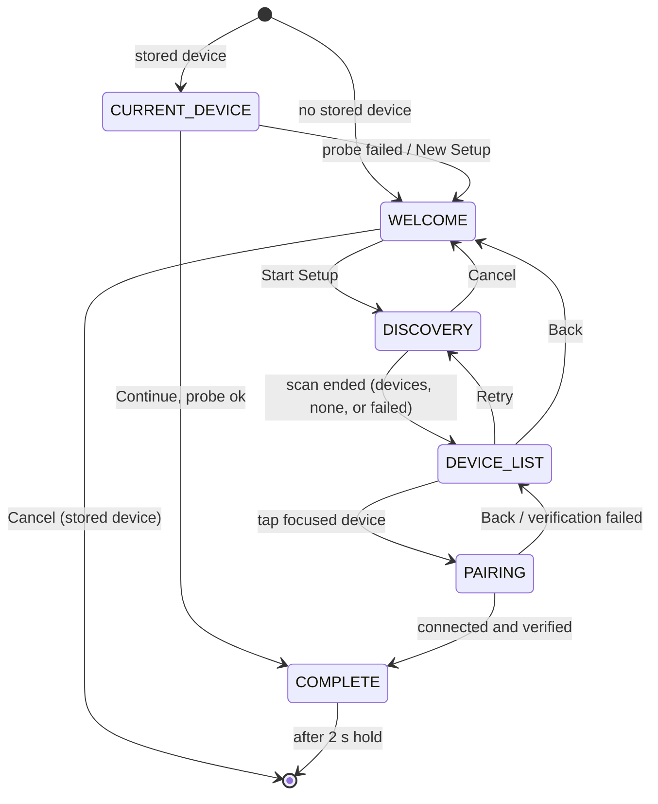

# Component Design: SetupDisplayManager

Created: 2025-12-29

## Table of Contents

- [1.0 Document Information](#10-document-information)
- [2.0 Component Overview](#20-component-overview)
- [3.0 Structure](#30-structure)
- [4.0 Setup Flow](#40-setup-flow)
- [5.0 Screen Behaviour](#50-screen-behaviour)
- [6.0 Operations and Cancellation](#60-operations-and-cancellation)
- [7.0 Visual Documentation](#70-visual-documentation)
- [Version History](#version-history)

---

## 1.0 Document Information

```yaml
document_info:
  document_id: "design-a3b4c5d6-component_display_setup_manager"
  tier: 3
  domain: "Display"
  component: "SetupDisplayManager"
  parent: "design-2c6b8e4d-domain_display.md"
  source_file: "src/gtach/display/setup.py"
  related_source_files:
    - "src/gtach/display/setup_models.py"
    - "src/gtach/display/setup_components/state/coordinator.py"
    - "src/gtach/display/setup_components/bluetooth/interface.py"
    - "src/gtach/display/async_operations.py"
  version: "2.2"
  date: "2026-11-12"
  author: "William Watson"
  status: "approved"
```

Version 2.0 replaces the 2025 class model, which described a structure that was never built (`setup_manager.py`, `SetupStep`, `BluetoothManager`, `async` methods). Sections 2.0 to 3.0 describe the source at commit `94ce959b`. Sections 4.0 to 6.0 state the target behaviour for change-34781bfe; each difference from the current source is marked **(change)**.

### 1.1 Parent Reference

- **Domain Design**: [design-2c6b8e4d-domain_display.md](design-2c6b8e4d-domain_display.md)

[Return to Table of Contents](#table-of-contents)

---

## 2.0 Component Overview

### 2.1 Purpose

SetupDisplayManager provides the Bluetooth setup screens: confirming a stored adapter, discovering adapters, selecting one, pairing and verifying it.

### 2.2 Responsibilities

1. Render the current setup screen onto the display surface.
2. Map touch positions to setup actions.
3. Run the setup thread, which starts discovery and pairing and calls the application's completion callback.
4. Present the outcome of every operation, including empty and failed scans.

[Return to Table of Contents](#table-of-contents)

---

## 3.0 Structure

| Element | Source | Role |
|---|---|---|
| `SetupDisplayManager` | `display/setup.py` | Rendering, touch regions, setup thread |
| `SetupState`, `SetupScreen`, `PairingStatus`, `SetupAction`, `BluetoothDevice` | `display/setup_models.py` | State and enumerations |
| `SetupStateCoordinator` | `setup_components/state/coordinator.py` | Sole owner of `SetupState`; readers get copies; transitions and change notifications |
| `BluetoothSetupInterface` | `setup_components/bluetooth/interface.py` | Starts discovery, pairing, OBD verification and the stored-device probe as async operations |
| `AsyncOperationManager` | `display/async_operations.py` | Two worker threads; operation status and completion callbacks |
| `BluetoothPairing` / `SimBluetoothPairing` | `comm/pairing.py`, `comm/sim_bluetooth.py` | Bluetooth back end, supplied through `pairing_factory` |

Rules that already hold and are kept:

- State is written only through the coordinator (`update_state`, `add_discovered_device`, `transition_to_screen`).
- Callbacks are invoked after locks are released (CLAUDE.md §4 rule 8).
- The setup thread is registered with ThreadManager as `setup` and sends heartbeats.

[Return to Table of Contents](#table-of-contents)

---

## 4.0 Setup Flow

### 4.1 Screens

`SetupScreen`: `WELCOME`, `CURRENT_DEVICE`, `DISCOVERY`, `DEVICE_LIST`, `PAIRING`, `COMPLETE`.

Setup opens on `CURRENT_DEVICE` when a primary device is stored, otherwise on `WELCOME`.

### 4.2 Transitions

| From | Event | To |
|---|---|---|
| `CURRENT_DEVICE` | Continue; probe succeeds | `COMPLETE` |
| `CURRENT_DEVICE` | Continue; probe fails | `WELCOME` with "Device not available" |
| `CURRENT_DEVICE` | New Setup | `WELCOME`; stored device removed |
| `WELCOME` | Start Setup | `DISCOVERY` |
| `WELCOME` | Cancel (shown only with a stored device) | Setup exits through the completion callback |
| `DISCOVERY` | Scan ends with devices | `DEVICE_LIST` |
| `DISCOVERY` | Scan ends with no device, or fails **(change)** | `DEVICE_LIST` showing "No devices found" or the failure text, with Back and Retry |
| `DISCOVERY` | Cancel | `WELCOME`; the scan is cancelled **(change)** |
| `DEVICE_LIST` | Tap focused device | `PAIRING` |
| `DEVICE_LIST` | Retry | `DISCOVERY` |
| `DEVICE_LIST` | Back | `WELCOME` |
| `PAIRING` | Connect and OBD verification succeed | `COMPLETE` |
| `PAIRING` | Connect fails | stays, with Retry and Back |
| `PAIRING` | OBD verification fails | `DEVICE_LIST` with the error line |
| `COMPLETE` | 2 s hold | completion callback; setup thread ends |

**(change)** A scan is started once per entry to `DISCOVERY`. The setup loop does not start another scan when one ends without devices.

### 4.3 Empty filtered scan (decision D1)

- Discovery lists devices whose name is classified as ELM327 or compatible.
- **(change)** When a scan ends with no such device but other named devices were seen, those devices are listed instead. No second scan is run: the fallback uses the names the same scan already returned, so it adds no scan time.
- **(change)** `DEVICE_LIST` then shows "No ELM327" on the error line (5.2). The list itself shows that all named devices are offered (change-146491ba; the longer text did not fit 220 px).
- The manual filter toggle and manual MAC entry are removed (decision D2).

Decision D1 was worded as "one automatic unfiltered pass". Using the first scan's results reaches the same outcome without a second pass; this refinement was approved on 2026-11-12. A scan with nothing in range takes about 36 s (device session A), which a second pass would double.

[Return to Table of Contents](#table-of-contents)

---

## 5.0 Screen Behaviour

### 5.1 DISCOVERY

- Title, spinner, progress text and a Cancel button.
- **(change)** Progress text comes from the operation's progress messages; today the generic text is always shown because the messages are not delivered (audit D02).

### 5.2 DEVICE_LIST

Defined by change-479b2e51; geometry and slot interior revised by change-d38362aa. Unchanged except where marked.

- Exactly three slots (top, middle, bottom) are drawn, whatever the discovered-device count. Slots are 60 px high with 10 px gaps; the column spans y=118–318 with the middle slot centred at y=218, in the band below the title and above Back/Retry. Slots are drawn at full scale and opacity.
- Each populated slot shows a type dot, the device name (FONT_BODY, truncated) and the type label (FONT_SMALL_TEXT) on the left, and four signal bars on the right (lit and unlit in contrasting greys). No RSSI text is shown.
- The middle slot shows the focused device (`focused_index`) with an accent border and background tint. It is the only touch region.
- The top and bottom slots show the previous and next device, or an outlined empty frame where none exists.
- A vertical swipe shifts `focused_index` by one, clamped to the discovered-device range. Arrows are indicators only, not touch targets.
- An up arrow (y=102–114) is drawn when a previous device exists; a down arrow (y=322–334) when a next device exists.
- An error or notice line, when present, is centred at y=84 between the title and the up arrow, fitted to 220 px.
- With zero devices, "No devices found" is shown and no slots or arrows are drawn. **(change)** This state is reachable (4.2).

### 5.3 PAIRING

- `CONNECTING`: spinner and status text; no buttons.
- `SUCCESS`: confirmation text while OBD verification runs. **(change)** No Continue button is shown; completion is automatic (audit C01).
- `FAILED`: error text with Retry and Back.

### 5.4 CURRENT_DEVICE

- Shows the stored device with Continue and New Setup.
- **(change)** While the probe runs, New Setup is not offered, and the probe result is applied only if the screen is still `CURRENT_DEVICE` (audit C08).

### 5.5 Spinners

- **(change)** The fade of the eight spinner dots is produced by blending each dot's colour toward the background, not by an alpha value, which the target surface ignores (audit C02).

[Return to Table of Contents](#table-of-contents)

---

## 6.0 Operations and Cancellation

**(change)** One rule replaces the present per-callback handling (audit X01, C08, D04):

1. `BluetoothSetupInterface` registers each started operation under its name (`device_discovery`, `device_pairing`, `device_probe`) with the operation id.
2. A completion callback acts only if its operation id is still the registered one for that name. Otherwise it returns without writing state.
3. Cancelling removes the registration first and then calls the back end's `cancel_discovery()` or `cancel_pairing()`. A running operation may finish later; rule 2 makes its completion harmless.
4. The Cancel action on `DISCOVERY`, leaving `PAIRING` with Back, and `stop_setup()` all cancel through this path.
5. `START_DISCOVERY`, `CANCEL` and `RETRY` reset the device list before the screen transition.

Supporting changes:

- Completed operations are removed from `AsyncOperationManager` once their callback has run (audit D03).
- Progress callbacks are passed to a task explicitly, not by inspecting its local variable names (audit D02).
- `on_pairing_complete` uses the result of `save_device()`; a failed save is reported on the error line (audit A09).

[Return to Table of Contents](#table-of-contents)

---

## 7.0 Visual Documentation



[Return to Table of Contents](#table-of-contents)

---

## Version History

| Version | Date | Author | Changes |
|---------|------|--------|---------|
| 1.0 | 2025-12-29 | William Watson | Initial component design document |
| 1.1 | 2026-10-02 | Claude | Added 5.3 DEVICE_LIST Screen Behaviour; updated 4.7 and 5.2 DEVICE_LIST interaction (change-479b2e51) |
| 1.2 | 2026-10-16 | Claude | 5.3: slot column geometry, slot interior, arrow and error-line positions (change-d38362aa) |
| 2.0 | 2026-11-11 | Claude | Rewritten against the source at `94ce959b`: the unbuilt 2025 class model removed; structure, flow, screen behaviour and the operation rule stated. Target behaviour for change-34781bfe marked "(change)": empty and failed scans reach DEVICE_LIST, unfiltered fallback (D1), effective cancellation, probe guard, no Continue button, spinner fade. DEVICE_LIST text carried over as 5.2. Layout converted to GFM heading links |
| 2.1 | 2026-11-12 | William Watson | Approved, including the D1 same-scan fallback in 4.3 |
| 2.2 | 2026-11-12 | Claude | 4.3: fallback notice text is "No ELM327" (change-146491ba) |

---

Copyright (c) 2026 William Watson. MIT License.
