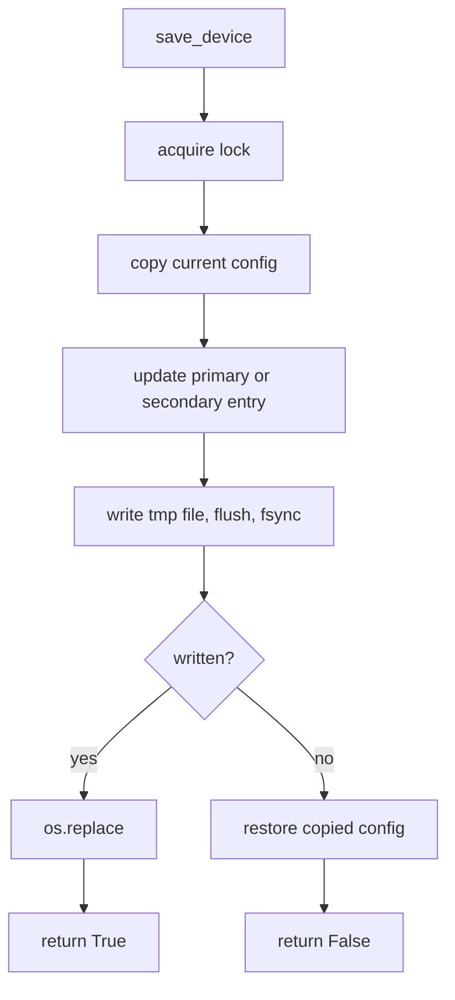

# Component Design: DeviceStore

Created: 2026 March 24

## Table of Contents

- [1.0 Document Information](#10-document-information)
- [2.0 Component Overview](#20-component-overview)
- [3.0 Interface](#30-interface)
- [4.0 Data Design](#40-data-design)
- [5.0 Error Handling](#50-error-handling)
- [6.0 Visual Documentation](#60-visual-documentation)
- [7.0 Related Documents](#70-related-documents)
- [Version History](#version-history)

---

## 1.0 Document Information

```yaml
document_info:
  document_id: "design-a6b7c8d9-component_comm_device_store"
  tier: 3
  domain: "Communication"
  component: "DeviceStore"
  parent: "design-7d3e9f5a-domain_comm.md"
  source_file: "src/gtach/comm/device_store.py"
  version: "1.2"
  date: "2026-11-13"
  author: "William Watson"
  status: "Implemented"
  supersedes: "design-f6a7b8c9-component_comm_device_store (closed)"
```

- **Domain design:** [design-7d3e9f5a-domain_comm.md](design-7d3e9f5a-domain_comm.md)

[Return to Table of Contents](#table-of-contents)

---

## 2.0 Component Overview

`DeviceStore` persists the paired ELM327 adapters in a YAML file. The persisted model, `BluetoothDevice`, is described in [design-a7b8c9d0](design-a7b8c9d0-component_comm_bluetooth_device.md).

Responsibilities:

1. Load and save `gtach_home()/config/devices.yaml` (default `/opt/gtach/config/devices.yaml`).
2. Hold one primary device and any number of secondary devices; return the primary device to `select_transport()` for `RFCOMMTransport`.
3. Serialise all access with an internal `threading.Lock`.
4. Provide one process-wide instance through `get_device_store()`.

[Return to Table of Contents](#table-of-contents)

---

## 3.0 Interface

```python
class DeviceStore:
    def __init__(self, config_path: Optional[str] = None): ...
    def save_device(self, device: BluetoothDevice, is_primary: bool = True) -> bool: ...
    def get_primary_device(self) -> Optional[BluetoothDevice]: ...
    def get_all_devices(self) -> List[BluetoothDevice]: ...
    def remove_device(self, mac_address: str) -> bool: ...
    def get_device_by_mac(self, mac_address: str) -> Optional[BluetoothDevice]: ...

def set_device_store_path(path: Optional[str]) -> None: ...
def get_device_store() -> DeviceStore: ...
def reset_device_store() -> None: ...
```

- `save_device` and `remove_device` return `True` only when the change reached disk. When a save fails, the in-memory state is restored to its previous content (audit A09).
- `set_device_store_path(path)` sets the file used by the shared instance and discards the current one (audit A10); `None` selects the default path.
- `get_device_store()` creates the shared instance on first use, through the module-level name `DeviceStore`, so that a test that patches the class gets its replacement. `reset_device_store()` discards it (tests).

### 3.1 Concurrency

Every public method holds the instance lock for its whole read or read-modify-save, including the file write, so that concurrent callers never interleave a load and a save (CLAUDE.md rule 8 permits a file-serialising lock across that file's I/O). Public methods delegate to `_..._locked` helpers and never call each other under the lock, because `threading.Lock` is not reentrant. No callback and no other component is called under the lock. The shared instance is guarded by a separate module lock.

[Return to Table of Contents](#table-of-contents)

---

## 4.0 Data Design

```yaml
paired_devices:
  primary:
    name: "ELM327"
    mac_address: "AA:BB:CC:DD:EE:FF"
    device_type: "ELM327"
    last_connected: "2026-03-24T10:00:00"   # optional
  secondary:                                 # optional
    "AA:BB:CC:DD:EE:00":
      name: "ELM327 backup"
      mac_address: "AA:BB:CC:DD:EE:00"
      device_type: "ELM327"
```

`_normalise_config()` runs after every load. It replaces a top level that is not a mapping, a `paired_devices` value that is not a mapping, and a `secondary` value that is not a mapping, each with an empty mapping and a WARNING. A missing file is created with `paired_devices: {}`.

Writes go to `<path>.tmp`, are flushed and `fsync`ed, and then replace the file with `os.replace` (issue-453f0a80).

[Return to Table of Contents](#table-of-contents)

---

## 5.0 Error Handling

| Condition | Handling |
|---|---|
| File missing | Create it with an empty store |
| YAML unreadable or malformed | ERROR with traceback; empty store in memory |
| Unexpected structure | WARNING; structure repaired in memory |
| Save failure | ERROR with traceback; the method returns `False`; in-memory state restored |
| Corrupt device entry on read | ERROR with traceback; the entry is skipped or `None` is returned |

Logger: `DeviceStore`. PyYAML is a required dependency; there is no in-memory fallback for a missing `yaml` module.

[Return to Table of Contents](#table-of-contents)

---

## 6.0 Visual Documentation

Purpose: the save path. Legend: rectangles are steps, diamonds are decisions.



[Return to Table of Contents](#table-of-contents)

---

## 7.0 Related Documents

- [design-a7b8c9d0-component_comm_bluetooth_device.md](design-a7b8c9d0-component_comm_bluetooth_device.md)
- [design-f8a9b0c1-component_utils_home.md](design-f8a9b0c1-component_utils_home.md) (`gtach_home()`)
- `closed/design-f6a7b8c9-component_comm_device_store.md` (superseded)
- Tests: `tests/test_device_store_shared.py`, `tests/test_low_defects.py`, `tests/test_medium_defects.py`

[Return to Table of Contents](#table-of-contents)

---

## Version History

| Version | Date | Description |
|---|---|---|
| 1.0 | 2026-03-24 | Initial component design; corrects cross-domain BluetoothDevice import; rationalises fields and interface |
| 1.1 | 2026-10-07 | [change-453f0a80](../change/closed/change-453f0a80-device-store-sharing.md): location under gtach_home(); internal lock; get_device_store()/reset_device_store(); fsync before replace. Matches commit 3747d2f. Supersedes design-f6a7b8c9. |
| 1.2 | 2026-11-13 | Retired design-f6a7b8c9 (already superseded by v1.1; nothing further to fold in). Corrected against the source: no `yaml` fallback, `_normalise_config`, `set_device_store_path`, boolean results and rollback on a failed save; transitional status text removed; `BluetoothDevice` detail left to design-a7b8c9d0; links converted to GitHub slugs (proposal-f8d0064b WP4). |

---

Copyright (c) 2026 William Watson. MIT License.
