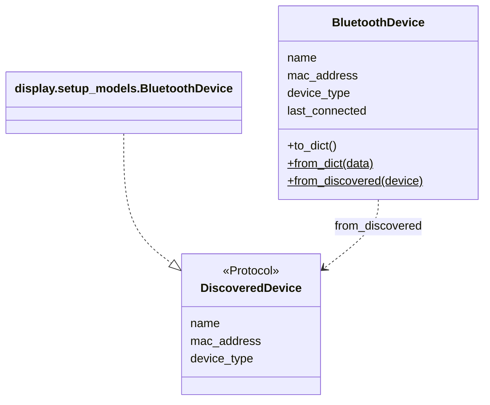

# Component Design: BluetoothDevice

Created: 2025-12-29

## Table of Contents

- [1.0 Document Information](#10-document-information)
- [2.0 Component Overview](#20-component-overview)
- [3.0 Interface](#30-interface)
- [4.0 Serialisation](#40-serialisation)
- [5.0 Visual Documentation](#50-visual-documentation)
- [6.0 Related Documents](#60-related-documents)
- [Version History](#version-history)

---

## 1.0 Document Information

```yaml
document_info:
  document_id: "design-a7b8c9d0-component_comm_bluetooth_device"
  tier: 3
  domain: "Communication"
  component: "BluetoothDevice"
  parent: "design-7d3e9f5a-domain_comm.md"
  source_file: "src/gtach/comm/models.py"
  version: "2.0"
  date: "2026-11-13"
  author: "William Watson"
  status: "Implemented"
```

- **Domain design:** [design-7d3e9f5a-domain_comm.md](design-7d3e9f5a-domain_comm.md)

[Return to Table of Contents](#table-of-contents)

---

## 2.0 Component Overview

`comm/models.py` defines the persisted device model of the Communication domain:

- `BluetoothDevice`, a dataclass with the identity of a paired adapter, stored by `DeviceStore`.
- `DiscoveredDevice`, a structural `Protocol` for a device found during setup.

A second class named `BluetoothDevice` exists in `display/setup_models.py`. It is the setup (discovery) model and carries signal strength, classification and pairing flags. `BluetoothDevice.from_discovered()` is the single conversion from the setup model to the persisted model; `DiscoveredDevice` lets `comm/models.py` accept the setup model without importing from the display package (issue-c9de5fb0).

[Return to Table of Contents](#table-of-contents)

---

## 3.0 Interface

```python
class DiscoveredDevice(Protocol):
    name: str
    mac_address: str
    device_type: str

@dataclass
class BluetoothDevice:
    name: str
    mac_address: str
    device_type: str = "UNKNOWN"
    last_connected: Optional[datetime.datetime] = None

    def to_dict(self) -> Dict[str, Any]: ...
    @classmethod
    def from_discovered(cls, device: DiscoveredDevice) -> "BluetoothDevice": ...
    @classmethod
    def from_dict(cls, data: Dict[str, Any]) -> "BluetoothDevice": ...
```

| Field | Notes |
|---|---|
| `name` | Display name |
| `mac_address` | Upper-cased in `__post_init__`; colons preserved |
| `device_type` | `UNKNOWN` by default; set to `ELM327` or `OBD` in `__post_init__` when the name contains `ELM` or `OBD` |
| `last_connected` | Optional; ISO 8601 in YAML |

[Return to Table of Contents](#table-of-contents)

---

## 4.0 Serialisation

- `to_dict()` returns `name`, `mac_address`, `device_type`, and `last_connected` (ISO 8601) only when set.
- `from_dict()` tolerates missing keys (`name` defaults to `"Unknown Device"`, `mac_address` to `""`, `device_type` to `"UNKNOWN"`). A `last_connected` value that is not an ISO 8601 string yields `None`.
- `from_discovered()` carries `name`, `mac_address` and `device_type`; `last_connected` is unset.

[Return to Table of Contents](#table-of-contents)

---

## 5.0 Visual Documentation

Purpose: the two device models and their conversion. Legend: dashed arrow is a structural (Protocol) match; solid arrow is a call.



[Return to Table of Contents](#table-of-contents)

---

## 6.0 Related Documents

- [design-a6b7c8d9-component_comm_device_store.md](design-a6b7c8d9-component_comm_device_store.md)
- [design-a3b4c5d6-component_display_setup_manager.md](design-a3b4c5d6-component_display_setup_manager.md)
- Tests: `tests/test_bluetooth_device_conversion.py`

[Return to Table of Contents](#table-of-contents)

---

## Version History

| Version | Date | Description |
|---|---|---|
| 1.0 | 2025-12-29 | Initial component design document |
| 2.0 | 2026-11-13 | Rewritten against the source: four-field persisted model, `DiscoveredDevice` protocol and `from_discovered()`; BLE-era fields removed; links converted to GitHub slugs (proposal-f8d0064b WP4). |

---

Copyright (c) 2026 William Watson. MIT License.
