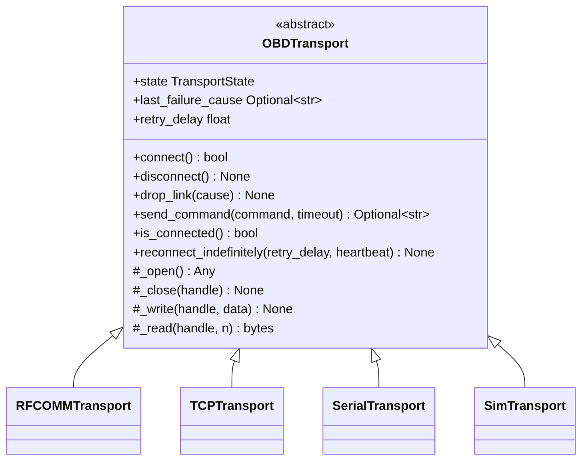
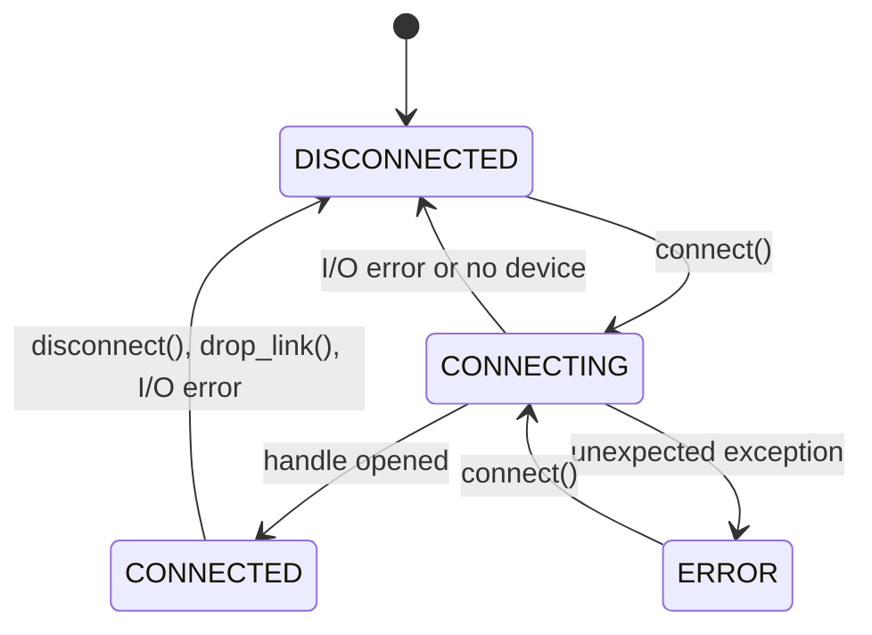

# Component Design: OBDTransport

Created: 2026 March 24

## Table of Contents

- [1.0 Document Information](#10-document-information)
- [2.0 Component Overview](#20-component-overview)
- [3.0 Module Constants](#30-module-constants)
- [4.0 Elements](#40-elements)
- [5.0 Behaviour](#50-behaviour)
- [6.0 Error Handling](#60-error-handling)
- [7.0 Visual Documentation](#70-visual-documentation)
- [8.0 Related Documents](#80-related-documents)
- [Version History](#version-history)

---

## 1.0 Document Information

```yaml
document_info:
  document_id: "design-b1c2d3e4-component_comm_transport"
  tier: 3
  domain: "Communication"
  component: "OBDTransport"
  parent: "design-7d3e9f5a-domain_comm.md"
  source_file: "src/gtach/comm/transport.py"
  version: "2.0"
  date: "2026-11-13"
  author: "William Watson"
  status: "Implemented"
```

- **Domain design:** [design-7d3e9f5a-domain_comm.md](design-7d3e9f5a-domain_comm.md)

[Return to Table of Contents](#table-of-contents)

---

## 2.0 Component Overview

`transport.py` holds the transport abstraction of the Communication domain:

- `OBDTransport`, the base class with the complete connection skeleton (connect, disconnect, drop, command exchange, supervision loop).
- `TransportState` and the `TransportError` exception hierarchy.
- The connect-failure cause strings shown on the DISCONNECTED screen.
- `select_transport()`, the factory used by `GTachApplication`.
- The transport name tuples read by `main.py`, `app.py` and `select_transport()`.

A concrete transport (`RFCOMMTransport`, `TCPTransport`, `SerialTransport`) supplies only how a handle is opened, closed, written to and read from. `SimTransport` overrides the whole skeleton.

Design constraint (issue-5e7a03c4): the transport reports faults and never acts on the host. It performs no adapter reset, rfkill cycle, hciuart restart, module reload or shell invocation.

[Return to Table of Contents](#table-of-contents)

---

## 3.0 Module Constants

| Name | Value | Purpose |
|---|---|---|
| `TRANSPORT_NAMES` | `("tcp", "serial", "rfcomm", "simtcp", "simbt")` | Valid `--transport` values |
| `TRANSPORT_FORCED` | `("tcp", "serial", "simtcp")` | Transports that skip setup mode |
| `TRANSPORT_FAST` | `("simbt", "simtcp", "tcp")` | Transports polled at 0.02 s instead of 0.05 s |
| `LINK_BUSY_CAUSE` | `"bluetooth link busy - may need reset"` | Cause for `EBUSY`; public for the post-pairing check |
| `LINK_RESET_CAUSE` | `"connection reset by adapter"` | Cause for `ECONNRESET` and `ECONNABORTED`; public for the post-pairing check |
| `_CONNECT_FAULT_CAUSES` | errno → cause | `EBUSY`, `ETIMEDOUT`, `EHOSTDOWN`, `EHOSTUNREACH`, `ENODEV`, `ENETDOWN`, `ECONNREFUSED`, `ECONNRESET`, `ECONNABORTED` |
| `_CONTROLLER_WORKING_CAUSES` | causes of `ECONNREFUSED` and `EHOSTDOWN` | Failures that show a working controller; excluded from the wedge diagnosis (issue-76ef5387) |
| `_SILENT_LINK_CAUSE` | `"adapter stopped responding"` | Default cause of `drop_link()` |
| `_PEER_CLOSED_CAUSE` | `"adapter closed the connection"` | Cause recorded on an EOF read |
| `_WEDGED_LINK_CAUSE` | `"bluetooth wedged - reset required"` | Escalated cause after sustained connect failures |

Every cause string is 40 characters or fewer so that it renders on the 480×480 display; a test asserts the bound.

[Return to Table of Contents](#table-of-contents)

---

## 4.0 Elements

### 4.1 TransportState

`DISCONNECTED`, `CONNECTING`, `CONNECTED`, `ERROR` (`enum.Enum`). `ERROR` is set only by an unexpected exception in `connect()`.

### 4.2 Exceptions

```python
class TransportError(Exception): ...
class TransportConnectionError(TransportError): ...
class TransportTimeoutError(TransportError): ...
class ProtocolError(TransportError): ...
```

`select_transport()` raises `TransportError`. The I/O paths of `OBDTransport` do not raise; they return `False` or `None` and record a cause.

### 4.3 OBDTransport

```python
class OBDTransport(ABC):
    _IO_ERRORS: tuple = (OSError,)
    _TIMEOUT_ERRORS: tuple = ()
    _EMPTY_READ_IS_EOF: bool = True
    _MAX_CONSECUTIVE_TIMEOUTS: int = 5
    _READ_DEADLINE_MARGIN_S: float = 1.0
    _MAX_CONSECUTIVE_CONNECT_FAILURES: int = 6
    _ADAPTER_CHECKS: bool = False
    _DISCARD_MAX_READS: int = 64

    def connect(self) -> bool: ...
    def disconnect(self) -> None: ...
    def drop_link(self, cause: Optional[str] = None) -> None: ...
    def send_command(self, command: str, timeout: float = 2.0) -> Optional[str]: ...
    def is_connected(self) -> bool: ...
    def reconnect_indefinitely(self, retry_delay: float = 5.0,
                               heartbeat: Optional[Callable[[], None]] = None) -> None: ...
    @property
    def state(self) -> TransportState: ...
    @property
    def last_failure_cause(self) -> Optional[str]: ...
    @property
    def retry_delay(self) -> float: ...

    # Handle primitives supplied by a subclass
    def _open(self) -> Any: ...
    def _close(self, handle: Any) -> None: ...
    def _write(self, handle: Any, data: bytes) -> None: ...
    def _read(self, handle: Any, n: int) -> bytes: ...
    def _set_timeout(self, handle: Any, timeout: float) -> None: ...   # optional override
    def _discard_input(self, handle: Any) -> int: ...                  # optional override
    def _describe(self) -> str: ...                                    # optional override
```

- The handle primitives are not `@abstractmethod`, because `SimTransport` supplies none of them. Direct instantiation of `OBDTransport` raises `TypeError`.
- State (`_handle`, `_state`, the two failure counters, `_last_failure_cause`) is guarded by `self._lock` (`threading.RLock`). No I/O and no call-out happens under the lock, except closing the handle in `_discard_handle_locked`.

### 4.4 select_transport

```python
def select_transport(platform_type: PlatformType, args: argparse.Namespace) -> OBDTransport
```

| `args.transport` | Result |
|---|---|
| `simtcp`, `simbt` | `SimTransport()` |
| `tcp` | `TCPTransport(host=args.obd_host, port=args.obd_port)` |
| `serial` | `SerialTransport(port=args.serial_port)` |
| `rfcomm` | `RFCOMMTransport` for the primary device of `get_device_store()` |
| not set, platform `RASPBERRY_PI_*` | as `rfcomm` |
| not set, other platform | `TransportError("Unsupported platform")` |

`TransportError("No paired device found")` is raised when RFCOMM is selected and the device store has no primary device.

[Return to Table of Contents](#table-of-contents)

---

## 5.0 Behaviour

### 5.1 connect

1. State `CONNECTING`; call `_open()` outside the lock.
2. `_open()` returns `None` (no device resolved): state `DISCONNECTED`, return `False`.
3. If `disconnect()` ran during a blocking `_open()`, the new handle is closed and not published (audit A01).
4. On success: publish the handle, state `CONNECTED`, clear the failure cause and the connect-failure counter.
5. On `_IO_ERRORS`: classify the cause (§5.5), log at ERROR, state `DISCONNECTED`, record the cause, return `False`.
6. On any other exception: log with traceback, state `ERROR`, return `False`.

### 5.2 send_command

1. Capture the handle once under the lock; `None` means not connected.
2. Discard stale input (`_discard_input`), so that a late reply to an earlier command is not read as this command's reply (issue-dc52c4e4).
3. Set the timeout, write `command + "\r"`, then read until `>` within a monotonic deadline of `timeout + _READ_DEADLINE_MARGIN_S`.
4. The reply ends at the first prompt; bytes after it are dropped.
5. An empty read is an EOF where `_EMPTY_READ_IS_EOF` is true: `drop_link(_PEER_CLOSED_CAUSE)`. Otherwise (serial) it is a timeout when nothing was buffered.
6. A timeout is counted by `_record_timeout`; `_MAX_CONSECUTIVE_TIMEOUTS` consecutive timeouts drop the link (issue-9c2f41d8). Any reply resets the count.
7. An I/O error on a handle that this process has since closed (`disconnect()` or `drop_link()`) is logged at DEBUG and changes neither state nor cause (issue-76ef5387). Any other I/O error is logged at ERROR, classified, and the handle discarded.

### 5.3 disconnect and drop_link

- `disconnect()` ends the transport's life: it sets `_shutdown`, which nothing clears, and closes the handle.
- `drop_link(cause)` closes only the current link and records the cause, so that `reconnect_indefinitely()` re-establishes it.

### 5.4 reconnect_indefinitely

Runs on the `transport` thread for the life of the process. It connects, polls `is_connected()` once per second while the link is up, and retries after `retry_delay` when the link drops or a connect fails. Its only exit is `_shutdown`. All waits use `wait_for_event` (issue-4f671d09). The optional `heartbeat` callable is invoked on every iteration and on every supervising poll; an exception from it is logged at DEBUG and swallowed.

### 5.5 Connect failure causes

- With `_ADAPTER_CHECKS` set (RFCOMM only), a missing controller in `/sys/class/bluetooth` overrides the errno and yields `"no bluetooth controller"`. An unreadable sysfs is treated as "controller present".
- A mapped errno yields its cause; an unmapped errno yields its symbolic name; otherwise the exception text.
- After `_MAX_CONSECUTIVE_CONNECT_FAILURES` consecutive failures with a controller present, the cause escalates to `_WEDGED_LINK_CAUSE`. Failures whose cause is in `_CONTROLLER_WORKING_CAUSES` neither count nor escalate. The counter resets only on a successful connect.

[Return to Table of Contents](#table-of-contents)

---

## 6.0 Error Handling

| Condition | Handling |
|---|---|
| Connect I/O error | ERROR record with cause; `last_failure_cause` set; `False` |
| Unexpected connect exception | ERROR record with traceback; state `ERROR`; `False` |
| Command timeout | WARNING; counted; link dropped at the threshold |
| Peer closed | `drop_link(_PEER_CLOSED_CAUSE)`; ERROR record; `None` |
| I/O error on a handle closed by this process | DEBUG; `None` |
| Other command I/O error | ERROR; cause recorded; handle discarded; `None` |
| Unsupported platform, or no paired device for RFCOMM | `TransportError` from `select_transport()` |

Loggers are named after the concrete class (`RFCOMMTransport`, `TCPTransport`, ...).

[Return to Table of Contents](#table-of-contents)

---

## 7.0 Visual Documentation

Purpose: class relationships of the transport layer. Legend: `<|--` inheritance.



Purpose: state transitions of `TransportState`.



[Return to Table of Contents](#table-of-contents)

---

## 8.0 Related Documents

- [design-c2d3e4f5-component_comm_rfcomm_transport.md](design-c2d3e4f5-component_comm_rfcomm_transport.md)
- [design-d3e4f5a6-component_comm_tcp_transport.md](design-d3e4f5a6-component_comm_tcp_transport.md)
- [design-e4f5a6b7-component_comm_serial_transport.md](design-e4f5a6b7-component_comm_serial_transport.md)
- [design-f5a6b7c8-component_comm_obd_protocol.md](design-f5a6b7c8-component_comm_obd_protocol.md)
- Tests: `tests/test_connect_error_classification.py`, `tests/test_comm_layer_defects.py`, `tests/test_reconnect_path.py`, `tests/test_link_loss_recovery.py`, `tests/test_response_alignment.py`, `tests/test_transport_heartbeat.py`

[Return to Table of Contents](#table-of-contents)

---

## Version History

| Version | Date | Description |
|---|---|---|
| 1.0 | 2026-03-24 | Initial component design |
| 2.0 | 2026-11-13 | Rewritten against the source: status corrected (the module exists); skeleton in the base class with handle primitives; `drop_link`, `last_failure_cause`, `retry_delay`; failure causes and wedge escalation; simulation transports; the macOS branch and the abstract-method interface removed; links converted to GitHub slugs (proposal-f8d0064b WP4). |

---

Copyright (c) 2026 William Watson. MIT License.
