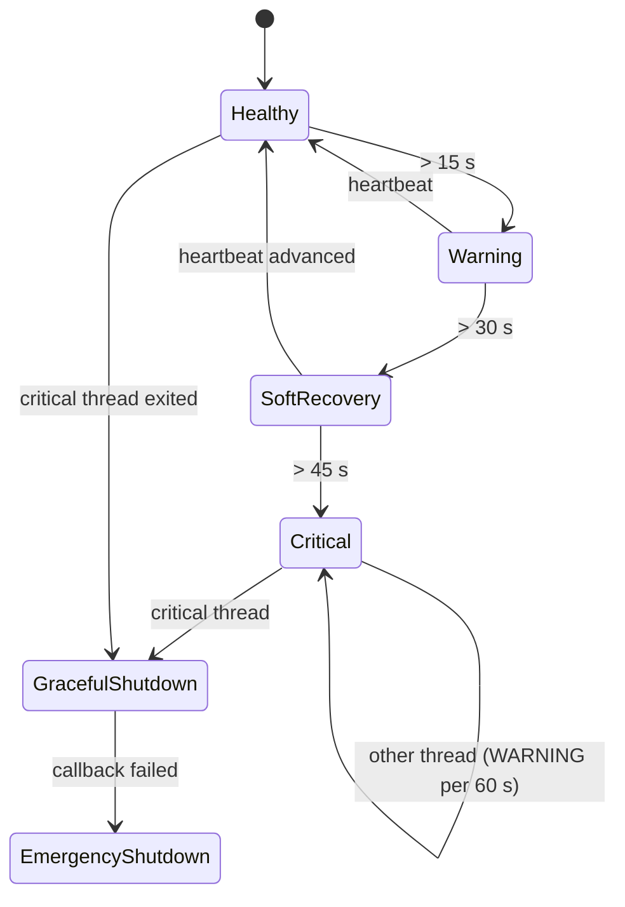

# Component Design: WatchdogMonitor

Created: 2025-12-29

## Table of Contents

- [1.0 Document Information](#10-document-information)
- [2.0 Component Overview](#20-component-overview)
- [3.0 Elements](#30-elements)
- [4.0 Behaviour](#40-behaviour)
- [5.0 Error Handling](#50-error-handling)
- [6.0 Visual Documentation](#60-visual-documentation)
- [7.0 Related Documents](#70-related-documents)
- [Version History](#version-history)

---

## 1.0 Document Information

```yaml
document_info:
  document_id: "design-b2c3d4e5-component_core_watchdog_monitor"
  tier: 3
  domain: "Core"
  component: "WatchdogMonitor"
  parent: "design-4f8a2b1c-domain_core.md"
  source_file: "src/gtach/core/watchdog.py"
  version: "2.0"
  date: "2026-11-13"
  author: "William Watson"
  status: "Implemented"
```

- **Domain design:** [design-4f8a2b1c-domain_core.md](design-4f8a2b1c-domain_core.md)

[Return to Table of Contents](#table-of-contents)

---

## 2.0 Component Overview

`WatchdogMonitor` checks the heartbeat of every thread registered with `ThreadManager` every `check_interval` seconds and responds in escalating steps. A stalled or exited critical thread leads to a graceful application shutdown; systemd then restarts the process. No thread is restarted in process (issue-860fd5f7).

[Return to Table of Contents](#table-of-contents)

---

## 3.0 Elements

```python
NON_CRITICAL_WARNING_INTERVAL_S = 60.0

class RecoveryLevel(Enum):
    WARNING, SOFT_RECOVERY, GRACEFUL_SHUTDOWN, EMERGENCY_SHUTDOWN

@dataclass
class RecoveryStats:
    warnings_issued: int = 0
    soft_recovery_attempts: int = 0
    soft_recovery_successes: int = 0
    shutdown_triggers: int = 0
    last_recovery_time: float = 0.0

@dataclass
class ThreadHealth:
    name: str
    last_warning_time: float = float("-inf")
    last_recovery_time: float = float("-inf")
    consecutive_failures: int = 0
    recovery_attempts: int = 0
    current_level: RecoveryLevel = RecoveryLevel.WARNING
    is_critical: bool = False
    last_critical_warning_time: float = float("-inf")

class WatchdogMonitor:
    def __init__(self, thread_manager: ThreadManager, check_interval: float = 5.0,
                 warning_timeout: float = 15.0, recovery_timeout: float = 30.0,
                 critical_timeout: float = 45.0,
                 shutdown_callback: Optional[Callable] = None): ...
    def start(self) -> None: ...
    def stop(self) -> None: ...
    def get_recovery_stats(self) -> RecoveryStats: ...
    def get_thread_health_status(self) -> Dict[str, Dict[str, Any]]: ...
```

| Attribute | Value | Meaning |
|---|---|---|
| `critical_threads` | `{"display", "obd_protocol"}` | A stall or exit triggers graceful shutdown |
| `advisory_threads` | `{"transport"}` | Reported at the warning level only; a blocking connect of tens of seconds is expected on a Bluetooth link |

[Return to Table of Contents](#table-of-contents)

---

## 4.0 Behaviour

### 4.1 Health check

Each cycle has two phases:

1. **Collect**, under `thread_manager._lock`, without any blocking call: for every thread in `RUNNING` or `STARTING`, determine the level from the time since its last heartbeat. A started thread that is no longer alive is marked `STOPPED` and recorded as exited.
2. **Dispatch**, with the lock released: run the handler for each collected item.

| Time since heartbeat | Level | Response |
|---|---|---|
| ≤ `warning_timeout` (15 s) | reset | Clear the failure counters |
| > 15 s | warning | WARNING, at most once per 30 s per thread |
| > `recovery_timeout` (30 s) | recovery | First occurrence: soft recovery. Later: ERROR "no in-process restart". At most once per 10 s |
| > `critical_timeout` (45 s) | critical | Critical thread: graceful shutdown. Other thread: WARNING at most once per 60 s, no action (issue-042dd7ff) |
| thread exited | exited | Critical thread: CRITICAL record and graceful shutdown. Other thread: INFO |

An advisory thread is clamped to the warning level.

### 4.2 Soft recovery

Reads the thread's heartbeat, sleeps 1.0 s with no lock held, and reads it again. A newer heartbeat counts as a success and resets the health record. No signal is sent and nothing is interrupted.

### 4.3 Shutdown

- `_initiate_graceful_shutdown(reason)` runs once. It calls `shutdown_callback` (`GTachApplication._watchdog_shutdown`), or `ThreadManager.shutdown()` when no callback was given.
- If that raises, `_emergency_shutdown()` waits 0.5 s for logging and calls `os._exit(1)`.
- `stop()` sets the stop event, joins the monitor thread for up to 5.0 s (not when called from the monitor thread itself) and logs the final statistics.

All intervals are measured with `time.monotonic()`; the loop waits with `wait_for_event`.

[Return to Table of Contents](#table-of-contents)

---

## 5.0 Error Handling

| Condition | Handling |
|---|---|
| Thread removed during soft recovery | DEBUG; recovery abandoned |
| Exception during soft recovery | ERROR with traceback |
| Graceful shutdown callback raises | ERROR with traceback; emergency shutdown |
| Monitor thread does not end in `stop()` | WARNING |

[Return to Table of Contents](#table-of-contents)

---

## 6.0 Visual Documentation

Purpose: escalation for one thread. Legend: transitions are labelled with the time since the last heartbeat.



[Return to Table of Contents](#table-of-contents)

---

## 7.0 Related Documents

- [design-a1b2c3d4-component_core_thread_manager.md](design-a1b2c3d4-component_core_thread_manager.md)
- Tests: `tests/test_watchdog_lock_discipline.py`, `tests/test_watchdog_process_termination.py`, `tests/test_monotonic_watchdog_timing.py`, `tests/test_thread_lifecycle.py`, `tests/test_lifecycle_logging_utils.py`

[Return to Table of Contents](#table-of-contents)

---

## Version History

| Version | Date | Description |
|---|---|---|
| 1.0 | 2025-12-29 | Initial component design document |
| 2.0 | 2026-11-13 | Rewritten against the source: two-phase health check outside the lock, critical and advisory threads, exited-thread detection, no in-process restart, non-critical warning interval, monotonic time; links converted to GitHub slugs (proposal-f8d0064b WP4). |

---

Copyright (c) 2026 William Watson. MIT License.
