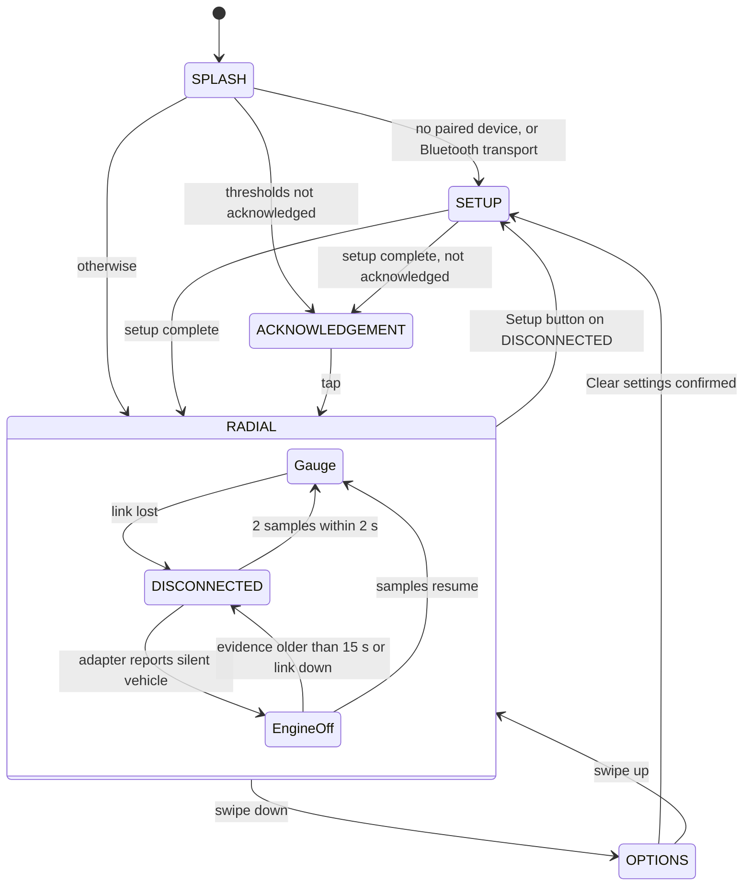

# Component Design: DisplayManager

Created: 2025-12-29

## Table of Contents

- [1.0 Document Information](#10-document-information)
- [2.0 Component Overview](#20-component-overview)
- [3.0 Class Design](#30-class-design)
- [4.0 Frame Loop](#40-frame-loop)
- [5.0 Display Modes and Screens](#50-display-modes-and-screens)
- [6.0 Gestures](#60-gestures)
- [7.0 Error Handling](#70-error-handling)
- [8.0 Visual Documentation](#80-visual-documentation)
- [9.0 Related Documents](#90-related-documents)
- [Version History](#version-history)

---

## 1.0 Document Information

```yaml
document_info:
  document_id: "design-b8c9d0e1-component_display_manager"
  tier: 3
  domain: "Display"
  component: "DisplayManager"
  parent: "design-2c6b8e4d-domain_display.md"
  source_file: "src/gtach/display/manager.py"
  version: "2.0"
  date: "2026-11-13"
  author: "William Watson"
  status: "Implemented"
```

- **Domain design:** [design-2c6b8e4d-domain_display.md](design-2c6b8e4d-domain_display.md)

[Return to Table of Contents](#table-of-contents)

---

## 2.0 Component Overview

`DisplayManager` owns the display thread. Each frame it evaluates the link state, draws the current screen into the back buffer of `DisplayRenderingEngine`, writes the frame to the framebuffer, and keeps the registered touch regions in step with the screen drawn.

Responsibilities:

1. Run the frame loop on the thread `display` at `fps_limit` frames per second, with a heartbeat per frame.
2. Draw the screens: splash, radial gauge, DISCONNECTED, Engine off, OPTIONS (menu, update, clear confirmation), acknowledgement; delegate setup screens to `SetupDisplayManager`.
3. Consume RPM samples from `ThreadManager.message_queue`, smooth them, and select the colour band.
4. Decide link loss and recovery, and the Engine off condition.
5. Handle gestures passed on by `TouchHandler`, and button regions through `TouchEventCoordinator`.
6. Load and save the display settings through `ConfigStore`.

Target display: Pimoroni HyperPixel 2.1 Round, 480×480, circular viewport. Geometry and font sizes are fixed by on-device measurement and are not derived here.

[Return to Table of Contents](#table-of-contents)

---

## 3.0 Class Design

```python
GAUGE_MAX_RPM_CAP = 9000
def gauge_full_scale(redline: float) -> int: ...   # min(9000, max(7000, ceil((redline + 500) / 1000) * 1000))

class DisplayManager:
    OPTIONS_PAGE_COUNT = 2
    LINK_LOSS_TIMEOUT = 2.0
    LINK_RECOVERY_SAMPLES = 2
    ENGINE_OFF_FRESHNESS_S = 15.0
    ENGINE_OFF_TEXT = "Engine off"

    def __init__(self, thread_manager: ThreadManager,
                 terminal_restorer: Optional[TerminalRestorer] = None,
                 config_store: Optional[ConfigStore] = None) -> None: ...
    def start(self) -> None: ...
    def start_splash(self) -> None: ...
    def stop(self) -> None: ...
    def set_setup_mode(self, setup_manager: SetupDisplayManager) -> None: ...
    def exit_setup_mode(self) -> None: ...
    def is_in_setup_mode(self) -> bool: ...
    def handle_touch_event(self, pos: Tuple[int, int]) -> Optional[object]: ...
    def get_performance_stats(self) -> Dict[str, Any]: ...
    def get_display_state(self) -> Dict[str, Any]: ...
```

### 3.1 Collaborators created by the constructor

| Attribute | Type | Purpose |
|---|---|---|
| `rendering_engine` | `DisplayRenderingEngine` | Surfaces and framebuffer output, initialised at 480×480 |
| `touch_coordinator` | `TouchEventCoordinator` | Button regions and hit testing |
| `touch_handler` | `TouchHandler` or `None` | Gesture classification on the touch interface |
| `performance_monitor` | `PerformanceMonitor` or `None` | Frame timing; periodic INFO line |
| `_splash_screen` | `SplashScreen` or `None` | Start-up screen, 4.0 s |
| `_ack_state_manager` | `AcknowledgementStateManager` | Acknowledgement of the RPM thresholds |
| `config` | `DisplayConfig` | Mode, `fps_limit`, `touch_long_press`, engine profile, `rpm_bands` |

A collaborator that fails to initialise is left `None` (or `display_available = False`) and logged once; the loop continues without it.

### 3.2 Callbacks injected by GTachApplication

| Attribute | Signature | Purpose |
|---|---|---|
| `_link_connected_callback` | `() -> bool` | Whether the transport is connected |
| `_link_cause_callback` | `() -> Optional[str]` | Failure cause for the DISCONNECTED screen |
| `_retry_interval_callback` | `() -> Any` | Retry period for the reconnect indicator |
| `_vehicle_silent_callback` | `() -> Optional[float]` | `OBDProtocol.last_vehicle_silent_ts()` |
| `_setup_entry_callback` | `() -> None` | Re-enter setup |
| `_reset_callback` | `() -> None` | Reboot the host (Reset button) |
| `_restart_callback` | `() -> None` | Restart the application after staging an update |
| `_debug_toggle_callback` | `(bool) -> None` | Switch debug logging at runtime |

[Return to Table of Contents](#table-of-contents)

---

## 4.0 Frame Loop

```text
while not stopped:
    _frame_link_lost  = _link_lost()
    _frame_engine_off = _engine_off()          (reset RPM conditioning on entry)
    if the view key changed: clear and register the touch regions for the view
    heartbeat("display")
    clear the back buffer
    SPLASH                -> splash screen; on completion _enter_post_splash_mode()
    setup mode            -> setup_manager.render(back buffer)
    otherwise             -> _render_normal_modes()
    write the frame to the framebuffer
    sleep the remainder of 1 / fps_limit
```

- `_render_normal_modes()` first drains the sample queue (latest value kept), then draws DISCONNECTED, the gauge, OPTIONS or the acknowledgement, then the status indicator. The drain precedes the link test, so that samples are consumed and recovery is possible while DISCONNECTED is shown (issue-4d9e2f18).
- `_current_view_key()` is `(mode, options sub-view, update status, disconnected, in setup mode, options page, engine off)`. Every state that decides which controls exist is part of the key.
- An exception in a frame is logged with traceback, followed by a 0.1 s sleep.
- `_enter_post_splash_mode()` enters ACKNOWLEDGEMENT when the current RPM bands and engine profile have not been acknowledged; otherwise the saved mode (RADIAL). A failure of the check resolves towards showing the notice.

[Return to Table of Contents](#table-of-contents)

---

## 5.0 Display Modes and Screens

### 5.1 DisplayMode

`SPLASH`, `RADIAL`, `OPTIONS`, `ACKNOWLEDGEMENT`. `RADIAL` is the only persistent mode; the others are transient and are never saved. A stored `DIGITAL` is read as `RADIAL` by `ConfigStore`. DISCONNECTED, Engine off and setup are conditions, not modes.

### 5.2 Radial gauge

- Arc of 300° from the 210° clock position, outer radius 232, inner radius 100, centre (240, 240).
- Full scale is `gauge_full_scale(redline)`: a multiple of 1000 from 7000 to 9000. A redline above full scale is off the dial and logged at WARNING on load (issue-2550e4ee).
- Tick marks and numerals per 1000 RPM; boundary marks at the band thresholds; the fill arc and the centre disc take the colour of the active band; the centre shows RPM / 1000 with one decimal.
- **Conditioning:** the displayed value is an exponential moving average of the raw sample with a 150 ms time constant, computed from the measured interval.
- **Bands:** six bands from the thresholds `idle_max`, `torque_start`, `caution_start`, `warning_start`, `danger_start` of `RPMBands`; band changes use a hysteresis of 75 RPM (at most 49 % of the narrowest band).
- **Palette:** `DAY_PALETTE` or `NIGHT_PALETTE`; the choice is saved. A notice ("Day" or "Night") is shown for 2 s after a change.

### 5.3 Link loss and DISCONNECTED

`_link_lost()` is evaluated once per frame. Every failure path returns `True`.

| Signal | Result |
|---|---|
| Simulation mode | Not lost |
| Transport callback returns `False` | Lost; latch cleared |
| No sample yet, or the latest sample older than `LINK_LOSS_TIMEOUT` (2.0 s) | Lost; latch cleared |
| Otherwise | Lost until `LINK_RECOVERY_SAMPLES` (2) samples have arrived within `LINK_LOSS_TIMEOUT` of one another |

In RADIAL, a lost link without Engine off shows the DISCONNECTED screen: title, the failure cause, a reconnect indicator, and the buttons **Setup** (re-enter setup) and **Reset** (reboot the host). OPTIONS stays reachable by swipe.

### 5.4 Engine off

A derived condition, like DISCONNECTED. It applies in RADIAL when the adapter is connected and answering but the vehicle is not ([design-f5a6b7c8 §5.0](design-f5a6b7c8-component_comm_obd_protocol.md#50-vehicle-silent-state)). Source: issue-b29cbd71.

`_frame_engine_off` is true only when all of the following hold:

1. `_frame_link_lost` is true (no live samples).
2. The transport callback returns exactly `True`.
3. `_vehicle_silent_callback()` returns a timestamp, and `time.monotonic() - timestamp <= ENGINE_OFF_FRESHNESS_S` (15.0 s).
4. Simulation mode is off.

Any failure, including an absent or raising callback, gives false, so the display falls back to DISCONNECTED. Engine off is never shown without fresh evidence from the adapter.

| Condition (RADIAL) | Screen | Status dot |
|---|---|---|
| Link lost and not engine off | DISCONNECTED | Red |
| Engine off | Gauge at 0 RPM with the text "Engine off" in place of the readout; no buttons | Yellow |
| Link up, not yet confirmed | Gauge | Yellow |
| Link confirmed | Gauge | Green |

On entry, the RPM conditioning state is reset (`_last_rpm = 0`, `_rpm_display = 0.0`, `_rpm_last_ts = None`, `_active_band = 0`), so the needle does not ease down from a stale value. The return to the live gauge follows §5.3.

### 5.5 OPTIONS

Two pages of two buttons (the circular viewport admits two 72 px targets per page):

| Page | Button | Action |
|---|---|---|
| 0 | Clear settings | Opens the confirmation; **Clear** removes every stored device and re-enters setup, **Cancel** returns |
| 0 | Check for updates | Opens the update view and scans on a worker thread |
| 1 | Bluetooth / Simulation mode | Toggles session-only synthetic RPM |
| 1 | Debug: On / Off | Toggles runtime debug logging |

Update view states: `checking`, `available` (**Install**, **Cancel**), `none`, `error` (**Back**), `pending`. **Install** stages the wheel with `updater.stage_pending()` and requests a restart; `bin/gtach-preflight.sh` installs it at the next start.

### 5.6 Acknowledgement

A full-screen notice of the RPM thresholds, dismissed by a tap anywhere. Dismissal is persisted by `AcknowledgementStateManager`; a change of thresholds or profile shows it again.

[Return to Table of Contents](#table-of-contents)

---

## 6.0 Gestures

`TouchHandler` classifies a touch on release and calls `DisplayManager`. Coordinates are scaled to 480×480.

| Gesture | Criterion | Mode | Action |
|---|---|---|---|
| Swipe down | Movement ≥ swipe threshold, mostly vertical, downward | RADIAL (including DISCONNECTED and Engine off) | Enter OPTIONS, page 0 |
| Swipe up | as above, upward | OPTIONS | Return to the mode OPTIONS was entered from |
| Swipe left / right | Movement ≥ swipe threshold, mostly horizontal | OPTIONS menu | Next / previous page, wrapping |
| Tap | Movement below the threshold, shorter than `touch_long_press` | any | Button under the touch, if any |
| Long press | Hold ≥ `touch_long_press` (default 1.0 s), movement below the threshold | RADIAL, not on a button | Toggle the day/night palette |
| Hold on a button | as long press, starting on a button | any | Presses that button |

- The swipe threshold is `TouchEventCoordinator.swipe_threshold` (50 px). Movement at or above it is a swipe whatever the duration (issue-2550e4ee).
- A touch whose start is older than 10 s is discarded.
- In setup mode every release goes to the setup manager; a vertical swipe on the device list moves the focus ([design-a3b4c5d6](design-a3b4c5d6-component_display_setup_manager.md)).
- Gestures are ignored in SPLASH and ACKNOWLEDGEMENT, except the dismissing tap.

This section replaces the retired `design-g1h2i3j4-gesture_reference`.

[Return to Table of Contents](#table-of-contents)

---

## 7.0 Error Handling

| Condition | Handling |
|---|---|
| Rendering engine fails to initialise | `display_available = False`; ERROR |
| Touch interface or splash unavailable | Component left `None`; ERROR once |
| Exception in a draw method | ERROR with traceback; the frame continues |
| Link state cannot be established | Treated as lost |
| Engine off evidence unavailable | Treated as not engine off |
| Configuration load fails | Defaults; ERROR |
| Configuration save fails | `False`; the palette change applies to the session only (WARNING) |

Logger: `DisplayManager`.

[Return to Table of Contents](#table-of-contents)

---

## 8.0 Visual Documentation

Purpose: the screens and the transitions between them. Legend: transitions are labelled with the gesture or condition.



[Return to Table of Contents](#table-of-contents)

---

## 9.0 Related Documents

- [design-c9d0e1f2-component_display_rendering_engine.md](design-c9d0e1f2-component_display_rendering_engine.md)
- [design-d0e1f2a3-component_display_touch_coordinator.md](design-d0e1f2a3-component_display_touch_coordinator.md)
- [design-f2a3b4c5-component_display_splash_screen.md](design-f2a3b4c5-component_display_splash_screen.md)
- [design-a3b4c5d6-component_display_setup_manager.md](design-a3b4c5d6-component_display_setup_manager.md)
- [design-f5a6b7c8-component_comm_obd_protocol.md](design-f5a6b7c8-component_comm_obd_protocol.md)
- Tests: `tests/test_disconnected_screen.py`, `tests/test_engine_off_state.py`, `tests/test_gauge_display_touch.py`, `tests/test_link_loss_recovery.py`, `tests/test_rpm_signal_conditioning.py`, `tests/test_touch_dispatch.py`, `tests/test_setup_and_gauge.py`, `tests/display/`

[Return to Table of Contents](#table-of-contents)

---

## Version History

| Version | Date | Description |
|---|---|---|
| 1.0 | 2025-12-29 | Initial component design document |
| 1.1 | 2026-03-13 | C3: fps_limit 60->30. C4: fixed 4-band background colour scheme; removed rpm_warning/rpm_danger from DisplayConfig; updated frame sequence and colour constants. H1: added DISCONNECTED mode, set_connection_state(), _render_disconnected(), updated transitions. |
| 1.2 | 2026-05-27 | Renamed SETTINGS → OPTIONS throughout. Added naming note re source code identifier lag. Updated DisplayMode enum, mode transitions table, gesture methods, and render loop diagram. |
| 1.3 | 2026-11-12 | §5.4: added Engine off condition — evaluation, precedence against DISCONNECTED, screen content, return to live. Other sections predate the current source (DIGITAL/GAUGE, long-press OPTIONS) and are not revised here (report-71ab3751-design-review) |
| 2.0 | 2026-11-13 | Rewritten against the source: RADIAL as the only layout (DIGITAL removed), OPTIONS by vertical swipe with paging, palette toggle by long press, link loss and recovery, DISCONNECTED with Setup and Reset, update view, acknowledgement, injected callbacks; §5.4 Engine off kept from v1.3; gesture table taken over from the retired design-g1h2i3j4; links converted to GitHub slugs (proposal-f8d0064b WP4). |

---

Copyright (c) 2026 William Watson. MIT License.
