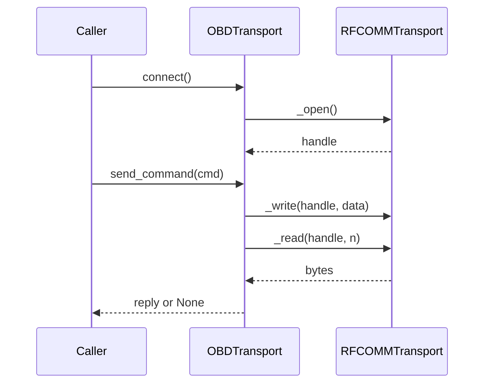

# Component Design: RFCOMMTransport

Created: 2026 March 24

## Table of Contents

- [1.0 Document Information](#10-document-information)
- [2.0 Component Overview](#20-component-overview)
- [3.0 Interface](#30-interface)
- [4.0 Handle Primitives](#40-handle-primitives)
- [5.0 Error Handling](#50-error-handling)
- [6.0 Visual Documentation](#60-visual-documentation)
- [7.0 Related Documents](#70-related-documents)
- [Version History](#version-history)

---

## 1.0 Document Information

```yaml
document_info:
  document_id: "design-c2d3e4f5-component_comm_rfcomm_transport"
  tier: 3
  domain: "Communication"
  component: "RFCOMMTransport"
  parent: "design-7d3e9f5a-domain_comm.md"
  source_file: "src/gtach/comm/rfcomm.py"
  version: "2.0"
  date: "2026-11-13"
  author: "William Watson"
  status: "Implemented"
```

- **Domain design:** [design-7d3e9f5a-domain_comm.md](design-7d3e9f5a-domain_comm.md)
- **Base class:** [design-b1c2d3e4-component_comm_transport.md](design-b1c2d3e4-component_comm_transport.md)

[Return to Table of Contents](#table-of-contents)

---

## 2.0 Component Overview

`RFCOMMTransport` connects to a paired ELM327 adapter over Classic Bluetooth (Serial Port Profile) with a kernel RFCOMM socket from the Python standard library. It is the production transport on the Raspberry Pi. It needs no `rfcomm` device node and no third-party Bluetooth library.

It is the only transport with `_ADAPTER_CHECKS = True`, so only it reports `"no bluetooth controller"` and the wedge cause.

[Return to Table of Contents](#table-of-contents)

---

## 3.0 Interface

```python
class RFCOMMTransport(OBDTransport):
    _IO_ERRORS = (OSError,)
    _TIMEOUT_ERRORS = (socket.timeout,)
    _ADAPTER_CHECKS = True

    def __init__(self, mac_address: str, channel: int = 1, retry_delay: float = 5.0): ...
```

| Parameter | Description |
|---|---|
| `mac_address` | Adapter address, taken from the primary device of the device store |
| `channel` | RFCOMM channel; 1 for the adapters in use |
| `retry_delay` | Seconds between reconnect attempts, read through `OBDTransport.retry_delay` |

[Return to Table of Contents](#table-of-contents)

---

## 4.0 Handle Primitives

| Primitive | Implementation |
|---|---|
| `_open()` | Raises `OSError` when `socket.AF_BLUETOOTH` is absent. Creates `socket(AF_BLUETOOTH, SOCK_STREAM, BTPROTO_RFCOMM)`, timeout 10 s, `connect((mac, channel))`, then blocking mode. The socket is closed on any exception, including `BaseException`, before re-raising (issue-5e7a03c4) |
| `_close(handle)` | `handle.close()` |
| `_write(handle, data)` | `handle.sendall(data)` |
| `_read(handle, n)` | `handle.recv(n)` |
| `_describe()` | `"RFCOMM device <mac> on channel <n>"` |

`_set_timeout` and `_discard_input` are inherited (`settimeout`, and `select`-based discard).

[Return to Table of Contents](#table-of-contents)

---

## 5.0 Error Handling

All handling is in `OBDTransport`. `socket.timeout` is listed in `_TIMEOUT_ERRORS` so that it is caught before `_IO_ERRORS` (it is an `OSError` subclass). Connect errors are classified by errno into the causes of design-b1c2d3e4 §3.0.

[Return to Table of Contents](#table-of-contents)

---

## 6.0 Visual Documentation

Purpose: the division of work between the base class and `RFCOMMTransport`. Legend: solid arrows are calls.



[Return to Table of Contents](#table-of-contents)

---

## 7.0 Related Documents

- [design-b1c2d3e4-component_comm_transport.md](design-b1c2d3e4-component_comm_transport.md)
- Tests: `tests/test_connect_error_classification.py`, `tests/test_reconnect_path.py`, `tests/test_comm_layer_defects.py`

[Return to Table of Contents](#table-of-contents)

---

## Version History

| Version | Date | Description |
|---|---|---|
| 1.0 | 2026-03-24 | Initial component design |
| 2.0 | 2026-11-13 | Rewritten against the source: status corrected (the module exists); the class supplies handle primitives only, the skeleton is in `OBDTransport`; links converted to GitHub slugs (proposal-f8d0064b WP4). |

---

Copyright (c) 2026 William Watson. MIT License.
