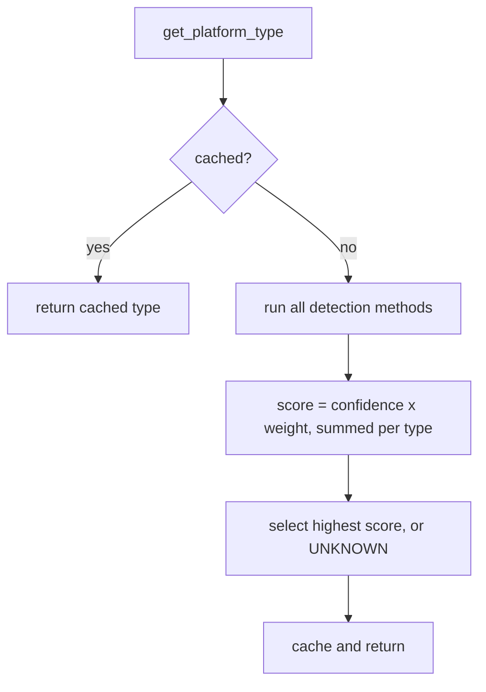

# Component Design: PlatformDetector

Created: 2025-12-29

## Table of Contents

- [1.0 Document Information](#10-document-information)
- [2.0 Component Overview](#20-component-overview)
- [3.0 Elements](#30-elements)
- [4.0 Behaviour](#40-behaviour)
- [5.0 Error Handling](#50-error-handling)
- [6.0 Visual Documentation](#60-visual-documentation)
- [7.0 Related Documents](#70-related-documents)
- [Version History](#version-history)

---

## 1.0 Document Information

```yaml
document_info:
  document_id: "design-c5d6e7f8-component_utils_platform_detector"
  tier: 3
  domain: "Utilities"
  component: "PlatformDetector"
  parent: "design-9a1f3c7e-domain_utils.md"
  source_file: "src/gtach/utils/platform.py"
  version: "2.0"
  date: "2026-11-13"
  author: "William Watson"
  status: "Implemented"
```

- **Domain design:** [design-9a1f3c7e-domain_utils.md](design-9a1f3c7e-domain_utils.md)

[Return to Table of Contents](#table-of-contents)

---

## 2.0 Component Overview

`PlatformDetector` identifies the hardware GTach runs on and reports its capabilities. The result selects the default transport (`select_transport()` uses RFCOMM on `RASPBERRY_PI_*`), the touch back end, and the platform-specific dependency checks. The runtime target is Linux on a Raspberry Pi; any other Linux host is `LINUX_GENERIC` and is used for development with an explicit `--transport`.

[Return to Table of Contents](#table-of-contents)

---

## 3.0 Elements

```python
class PlatformType(Enum):
    RASPBERRY_PI_ZERO, RASPBERRY_PI_ZERO_2W, RASPBERRY_PI_4, RASPBERRY_PI_5,
    RASPBERRY_PI_GENERIC, LINUX_GENERIC, WINDOWS, UNKNOWN

class DetectionMethod(Enum):
    DEVICE_TREE, PROC_CPUINFO, BCM_GPIO, SYSTEM_PLATFORM, HARDWARE_REVISION

@dataclass
class DetectionResult:
    method: DetectionMethod
    platform_type: PlatformType
    confidence: float
    evidence: ...
    error: Optional[str] = None

@dataclass
class PlatformCapabilities:
    gpio_available: bool = False
    gpio_accessible: bool = False
    gpio_permissions: bool = False
    display_hardware: bool = False
    bluetooth_available: bool = False
    i2c_available: bool = False
    spi_available: bool = False

class PlatformDetector:
    def get_platform_type(self, force_refresh: bool = False) -> PlatformType: ...
    def check_gpio_availability(self, force_refresh: bool = False) -> PlatformCapabilities: ...
    def is_raspberry_pi(self) -> bool: ...
    def is_gpio_available(self) -> bool: ...
    def get_platform_info(self) -> Dict[str, Any]: ...
    def clear_cache(self) -> None: ...

def get_detector() -> PlatformDetector: ...      # process-wide instance, created under a lock
def get_platform_type() -> PlatformType: ...
def is_raspberry_pi() -> bool: ...
def is_gpio_available() -> bool: ...
def get_platform_info() -> Dict[str, Any]: ...
```

[Return to Table of Contents](#table-of-contents)

---

## 4.0 Behaviour

### 4.1 Detection

All detection methods run; each returns a `DetectionResult` with a confidence. `_resolve_conflicts()` sums `confidence × weight` per platform type and selects the highest score. Failed methods are skipped; with no usable result the type is `UNKNOWN`.

| Method | Source | Weight |
|---|---|---|
| `DEVICE_TREE` | `/proc/device-tree/model` | 1.0 |
| `HARDWARE_REVISION` | Revision code in `/proc/cpuinfo` | 0.9 |
| `PROC_CPUINFO` | Hardware and model lines of `/proc/cpuinfo` | 0.8 |
| `BCM_GPIO` | Presence of BCM GPIO devices | 0.6 |
| `SYSTEM_PLATFORM` | `platform` module | 0.4 |

The result is cached; `force_refresh=True` or `clear_cache()` repeats the detection.

### 4.2 Capabilities

`check_gpio_availability()` fills `PlatformCapabilities` from device nodes and sysfs: GPIO devices, access and permissions, display hardware, a Bluetooth controller under `/sys/class/bluetooth`, I2C and SPI. `RPi.GPIO` is imported conditionally.

### 4.3 Module functions

The module-level functions delegate to the shared detector and never raise: on an exception they log and return `False`, `UNKNOWN` or an empty mapping.

[Return to Table of Contents](#table-of-contents)

---

## 5.0 Error Handling

| Condition | Handling |
|---|---|
| A detection source is missing or unreadable | That method reports an error and is ignored in the scoring |
| No method succeeds | `PlatformType.UNKNOWN` |
| `RPi.GPIO` not installed | GPIO reported as not accessible |

Logger: `PlatformDetector`.

[Return to Table of Contents](#table-of-contents)

---

## 6.0 Visual Documentation

Purpose: the detection flow. Legend: rectangles are steps, the diamond is a decision.



[Return to Table of Contents](#table-of-contents)

---

## 7.0 Related Documents

- [design-b1c2d3e4-component_comm_transport.md](design-b1c2d3e4-component_comm_transport.md) (`select_transport`)
- [design-e7f8a9b0-component_utils_dependency_validator.md](design-e7f8a9b0-component_utils_dependency_validator.md)
- Tests: `tests/test_platform_detection.py`

[Return to Table of Contents](#table-of-contents)

---

## Version History

| Version | Date | Description |
|---|---|---|
| 1.0 | 2025-12-29 | Initial component design document |
| 2.0 | 2026-11-13 | Rewritten against the source: Linux-only platform types (no macOS), weighted multi-method detection, capabilities, module-level functions; links converted to GitHub slugs (proposal-f8d0064b WP4). |

---

Copyright (c) 2026 William Watson. MIT License.
