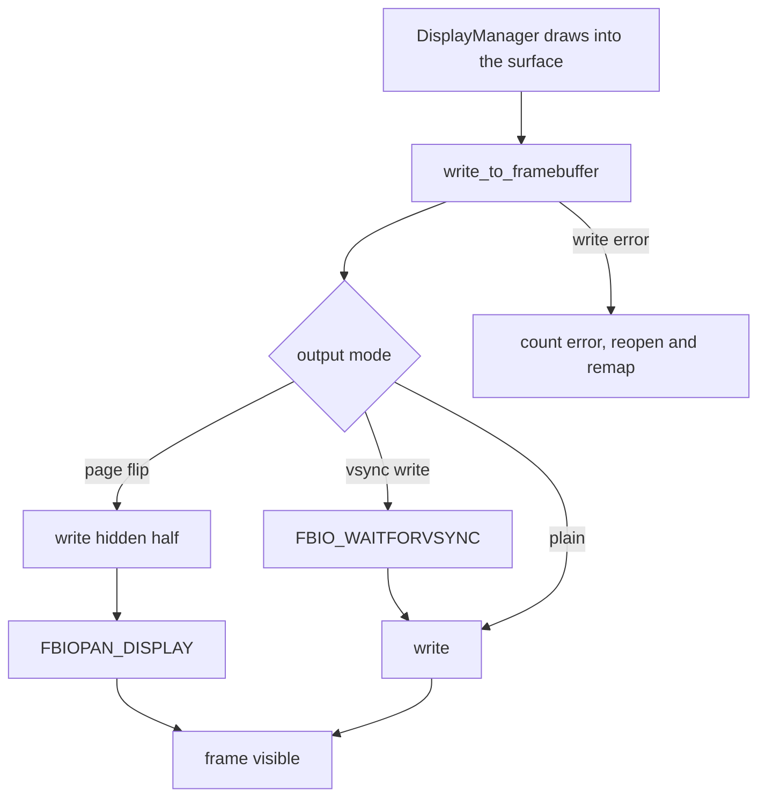

# Component Design: DisplayRenderingEngine

Created: 2025-12-29

## Table of Contents

- [1.0 Document Information](#10-document-information)
- [2.0 Component Overview](#20-component-overview)
- [3.0 Interface](#30-interface)
- [4.0 Behaviour](#40-behaviour)
- [5.0 Error Handling](#50-error-handling)
- [6.0 Visual Documentation](#60-visual-documentation)
- [7.0 Related Documents](#70-related-documents)
- [Version History](#version-history)

---

## 1.0 Document Information

```yaml
document_info:
  document_id: "design-c9d0e1f2-component_display_rendering_engine"
  tier: 3
  domain: "Display"
  component: "DisplayRenderingEngine"
  parent: "design-2c6b8e4d-domain_display.md"
  source_files:
    - "src/gtach/display/rendering/engine.py"
    - "src/gtach/display/rendering/interfaces.py"
  version: "2.0"
  date: "2026-11-13"
  author: "William Watson"
  status: "Implemented"
```

- **Domain design:** [design-2c6b8e4d-domain_display.md](design-2c6b8e4d-domain_display.md)

[Return to Table of Contents](#table-of-contents)

---

## 2.0 Component Overview

`DisplayRenderingEngine` owns the pygame surface that every screen is drawn into and writes each finished frame to the Linux framebuffer. pygame runs with `SDL_VIDEODRIVER=dummy`; no window system is used. The output path is `/dev/fb0`, memory-mapped.

On a host without a usable framebuffer (development, tests) the engine initialises without output and drawing still works on the surface.

[Return to Table of Contents](#table-of-contents)

---

## 3.0 Interface

```python
class RenderTarget(Enum):  MAIN, BACK_BUFFER, FRAMEBUFFER

@dataclass
class RenderingStats:
    frames_rendered: int = 0
    total_render_time: float = 0.0
    average_render_time: float = 0.0
    last_render_time: float = 0.0
    surfaces_created: int = 0
    buffer_writes: int = 0
    framebuffer_errors: int = 0

class DisplayRenderingEngine(RenderingEngineInterface):
    VERTICAL_OFFSET_PX = 0

    def initialize(self, surface_size: Tuple[int, int], framebuffer_path: str = "/dev/fb0") -> bool: ...
    def is_initialized(self) -> bool: ...
    def create_surface(self, size, alpha: bool = False) -> Optional[pygame.Surface]: ...
    def get_surface(self, target: RenderTarget) -> Optional[pygame.Surface]: ...
    def clear_surface(self, target, color=(0, 0, 0)) -> None: ...
    def draw_circle(self, target, color, center, radius, width=0) -> None: ...
    def draw_rect(self, target, color, rect, width=0, border_radius=0) -> None: ...
    def draw_line(self, target, color, start_pos, end_pos, width=1) -> None: ...
    def blit_surface(self, target, source, dest, area=None) -> None: ...
    def render_text(self, target, text, font, color, position, center=True) -> pygame.Rect: ...
    def swap_buffers(self) -> bool: ...
    def write_to_framebuffer(self) -> bool: ...
    def record_frame(self) -> None: ...
    def get_stats(self) -> RenderingStats: ...
    def validate_circular_bounds(self, center, radius, safe_radius=None) -> bool: ...
    def cleanup(self) -> None: ...
```

- `main_surface` and `back_surface` are the same 32-bit surface; `RenderTarget.MAIN` and `BACK_BUFFER` resolve to it. `swap_buffers()` is a no-op kept for the interface.
- Operations are guarded by an internal `threading.RLock`.

[Return to Table of Contents](#table-of-contents)

---

## 4.0 Behaviour

### 4.1 Initialisation

1. Set `SDL_VIDEODRIVER=dummy`; initialise pygame display and fonts.
2. Create the 480×480, 32-bit surface.
3. Open the framebuffer device and read its geometry: resolution and depth by `FBIOGET_VSCREENINFO`, stride from `/sys/class/graphics/<node>/stride`. A depth other than 32 bit, a resolution other than the surface, or an unexpected stride is logged at ERROR; the engine does not adapt the composed surface.
4. Map the framebuffer with `mmap`; fall back to file writes if mapping fails.
5. Select the output mode, in this order: page flip (a virtual resolution of twice the height, with `FBIOPAN_DISPLAY` between the two halves), vsync-synchronised write (`FBIO_WAITFORVSYNC`), plain write.

### 4.2 Frame output

`write_to_framebuffer()` copies the surface bytes to the framebuffer. With page flip it writes the half that is not displayed and pans to it. A size mismatch between the surface and the buffer is handled without raising and logged once. A failed write increments `framebuffer_errors` and triggers `_attempt_framebuffer_recovery()` (reopen and remap).

### 4.3 Cleanup

`cleanup()` restores the original variable screen information (when page flip changed it), unmaps and closes the framebuffer, and quits pygame display.

[Return to Table of Contents](#table-of-contents)

---

## 5.0 Error Handling

| Condition | Handling |
|---|---|
| pygame missing | Mock initialisation; drawing calls are no-ops |
| Framebuffer cannot be opened | Engine initialised without output; WARNING |
| Geometry query fails | Assumed dimensions; WARNING |
| Geometry differs from 480×480 at 32 bit | ERROR; output continues |
| Write fails | Error counted; recovery attempted |
| Drawing call raises | ERROR with traceback; the call returns |

Logger: `DisplayRenderingEngine`.

[Return to Table of Contents](#table-of-contents)

---

## 6.0 Visual Documentation

Purpose: the path of one frame. Legend: rectangles are steps, diamonds are decisions.



[Return to Table of Contents](#table-of-contents)

---

## 7.0 Related Documents

- [design-b8c9d0e1-component_display_manager.md](design-b8c9d0e1-component_display_manager.md)
- Tests: `tests/display/rendering/`, `tests/test_medium_defects.py`, `tests/test_low_defects.py`

[Return to Table of Contents](#table-of-contents)

---

## Version History

| Version | Date | Description |
|---|---|---|
| 1.0 | 2025-12-29 | Initial component design document |
| 2.0 | 2026-11-13 | Rewritten against the source: source path corrected to `display/rendering/engine.py`; single surface, framebuffer geometry query, page flip and vsync output modes, recovery; links converted to GitHub slugs (proposal-f8d0064b WP4). |

---

Copyright (c) 2026 William Watson. MIT License.
