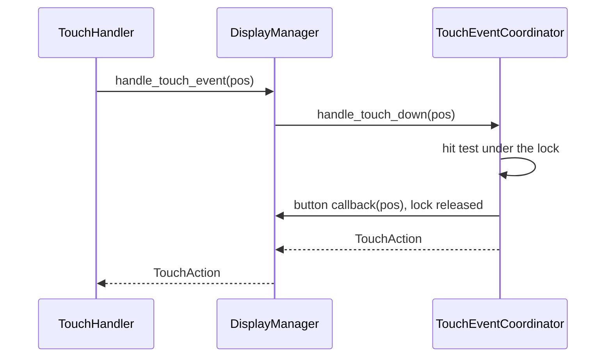

# Component Design: TouchEventCoordinator

Created: 2025-12-29

## Table of Contents

- [1.0 Document Information](#10-document-information)
- [2.0 Component Overview](#20-component-overview)
- [3.0 Interface](#30-interface)
- [4.0 Behaviour](#40-behaviour)
- [5.0 Error Handling](#50-error-handling)
- [6.0 Visual Documentation](#60-visual-documentation)
- [7.0 Related Documents](#70-related-documents)
- [Version History](#version-history)

---

## 1.0 Document Information

```yaml
document_info:
  document_id: "design-d0e1f2a3-component_display_touch_coordinator"
  tier: 3
  domain: "Display"
  component: "TouchEventCoordinator"
  parent: "design-2c6b8e4d-domain_display.md"
  source_files:
    - "src/gtach/display/input/touch_coordinator.py"
    - "src/gtach/display/input/interfaces.py"
  version: "2.0"
  date: "2026-11-13"
  author: "William Watson"
  status: "Implemented"
```

- **Domain design:** [design-2c6b8e4d-domain_display.md](design-2c6b8e4d-domain_display.md)

[Return to Table of Contents](#table-of-contents)

---

## 2.0 Component Overview

`TouchEventCoordinator` is the registry of touch regions for the screen currently drawn. `DisplayManager` registers one region per button; a tap is hit-tested against the regions and the matching button's callback is invoked.

Gesture classification (swipe, tap, long press) is not done here; it is done by `TouchHandler` (`display/touch.py`) and described in [design-b8c9d0e1 §6.0](design-b8c9d0e1-component_display_manager.md#60-gestures). The coordinator supplies the swipe threshold that `TouchHandler` uses.

[Return to Table of Contents](#table-of-contents)

---

## 3.0 Interface

```python
class TouchAction(Enum):  NONE, SETTINGS_CHANGE, NAVIGATION, BUTTON_PRESS

@dataclass
class TouchRegion:
    region_id: str
    rect: pygame.Rect
    action_type: TouchAction
    metadata: Dict[str, Any]
    enabled: bool = True

class TouchEventCoordinator(TouchEventInterface):
    def __init__(self, display_bounds: Tuple[int, int] = (480, 480)): ...
    swipe_threshold = 50          # pixels; instance attribute

    def register_region(self, region: TouchRegion) -> bool: ...
    def register_button_region(self, region_id: str, rect: pygame.Rect,
                               action_type: TouchAction = TouchAction.BUTTON_PRESS,
                               callback: Optional[Callable] = None) -> bool: ...
    def unregister_region(self, region_id: str) -> bool: ...
    def clear_regions(self) -> None: ...
    def handle_touch_down(self, pos: Tuple[int, int]) -> Optional[TouchAction]: ...
    def is_button_at(self, pos: Tuple[int, int]) -> bool: ...
    def get_active_regions(self) -> List[TouchRegion]: ...
    def validate_coordinates(self, pos: Tuple[int, int]) -> bool: ...
    def get_stats(self) -> Dict[str, Any]: ...
```

[Return to Table of Contents](#table-of-contents)

---

## 4.0 Behaviour

- **Registration:** `register_button_region()` stores a region whose metadata holds the callback. `DisplayManager` clears and re-registers all regions whenever its view key changes, so the regions always match the screen drawn.
- **Dispatch:** `handle_touch_down(pos)` validates the coordinates against the display bounds, finds the first enabled region containing the point, and returns its `TouchAction`. The button callback is captured under the lock and invoked after the lock is released (CLAUDE.md rule 8); it receives the position.
- **`is_button_at(pos)`** reports whether a button region contains the point; `TouchHandler` uses it to turn a hold that starts on a button into a press of that button.
- All registry access is guarded by an internal `threading.RLock`. Regions are registered on the display thread and hit-tested on the touch thread.

[Return to Table of Contents](#table-of-contents)

---

## 5.0 Error Handling

| Condition | Handling |
|---|---|
| Coordinates outside the display bounds | No action; `None` |
| No region at the point | `TouchAction.NONE` |
| Button callback raises | ERROR with traceback; the action type is still returned |

Logger: `TouchEventCoordinator`.

[Return to Table of Contents](#table-of-contents)

---

## 6.0 Visual Documentation

Purpose: dispatch of one tap. Legend: solid arrows are calls, dashed arrows are returns.



[Return to Table of Contents](#table-of-contents)

---

## 7.0 Related Documents

- [design-b8c9d0e1-component_display_manager.md](design-b8c9d0e1-component_display_manager.md)
- Tests: `tests/test_touch_dispatch.py`, `tests/test_callbacks_outside_locks.py`, `tests/test_gauge_display_touch.py`

[Return to Table of Contents](#table-of-contents)

---

## Version History

| Version | Date | Description |
|---|---|---|
| 1.0 | 2025-12-29 | Initial component design document |
| 2.0 | 2026-11-13 | Rewritten against the source: source path corrected to `display/input/touch_coordinator.py`; region registry and button dispatch only, gesture classification is in `TouchHandler`; callback outside the lock; links converted to GitHub slugs (proposal-f8d0064b WP4). |

---

Copyright (c) 2026 William Watson. MIT License.
