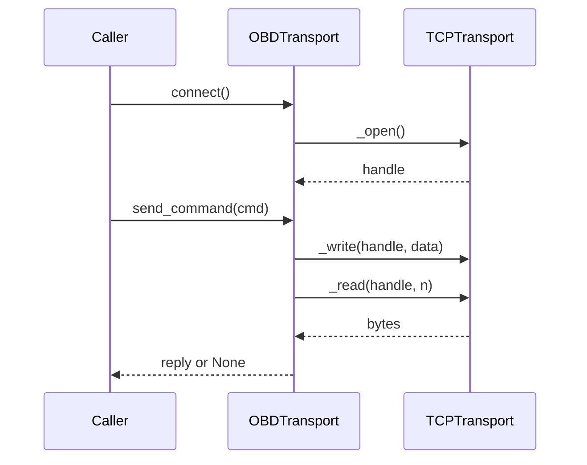

# Component Design: TCPTransport

Created: 2026 March 24

## Table of Contents

- [1.0 Document Information](#10-document-information)
- [2.0 Component Overview](#20-component-overview)
- [3.0 Interface](#30-interface)
- [4.0 Handle Primitives](#40-handle-primitives)
- [5.0 Error Handling](#50-error-handling)
- [6.0 Visual Documentation](#60-visual-documentation)
- [7.0 Related Documents](#70-related-documents)
- [Version History](#version-history)

---

## 1.0 Document Information

```yaml
document_info:
  document_id: "design-d3e4f5a6-component_comm_tcp_transport"
  tier: 3
  domain: "Communication"
  component: "TCPTransport"
  parent: "design-7d3e9f5a-domain_comm.md"
  source_file: "src/gtach/comm/tcp_transport.py"
  version: "2.0"
  date: "2026-11-13"
  author: "William Watson"
  status: "Implemented"
```

- **Domain design:** [design-7d3e9f5a-domain_comm.md](design-7d3e9f5a-domain_comm.md)
- **Base class:** [design-b1c2d3e4-component_comm_transport.md](design-b1c2d3e4-component_comm_transport.md)

[Return to Table of Contents](#table-of-contents)

---

## 2.0 Component Overview

`TCPTransport` connects to an ELM327 emulator or a WiFi adapter over TCP. It is a development and bench-test transport, selected with `--transport tcp --obd-host HOST --obd-port PORT`. It is a forced transport (setup mode is skipped) and a fast transport (0.02 s poll interval).

[Return to Table of Contents](#table-of-contents)

---

## 3.0 Interface

```python
class TCPTransport(OBDTransport):
    _IO_ERRORS = (OSError,)
    _TIMEOUT_ERRORS = (socket.timeout,)

    def __init__(self, host: str = "localhost", port: int = 35000, retry_delay: float = 5.0): ...
```

[Return to Table of Contents](#table-of-contents)

---

## 4.0 Handle Primitives

| Primitive | Implementation |
|---|---|
| `_open()` | `socket(AF_INET, SOCK_STREAM)`, timeout 10 s, `connect((host, port))`, then blocking mode. The socket is closed on any exception before re-raising (issue-4005360c) |
| `_close(handle)` | `handle.close()` |
| `_write(handle, data)` | `handle.sendall(data)` |
| `_read(handle, n)` | `handle.recv(n)` |
| `_describe()` | `"TCP device <host>:<port>"` |

[Return to Table of Contents](#table-of-contents)

---

## 5.0 Error Handling

All handling is in `OBDTransport`. `_ADAPTER_CHECKS` is false, so a TCP failure never reports a Bluetooth adapter cause (audit A05). `ConnectionRefusedError` is covered by `OSError`.

[Return to Table of Contents](#table-of-contents)

---

## 6.0 Visual Documentation

Purpose: the division of work between the base class and `TCPTransport`. Legend: solid arrows are calls.



[Return to Table of Contents](#table-of-contents)

---

## 7.0 Related Documents

- [design-b1c2d3e4-component_comm_transport.md](design-b1c2d3e4-component_comm_transport.md)
- Tests: `tests/test_comm_layer_defects.py`, `tests/test_response_alignment.py`

[Return to Table of Contents](#table-of-contents)

---

## Version History

| Version | Date | Description |
|---|---|---|
| 1.0 | 2026-03-24 | Initial component design |
| 2.0 | 2026-11-13 | Rewritten against the source: status corrected (the module exists); the class supplies handle primitives only, the skeleton is in `OBDTransport`; links converted to GitHub slugs (proposal-f8d0064b WP4). |

---

Copyright (c) 2026 William Watson. MIT License.
