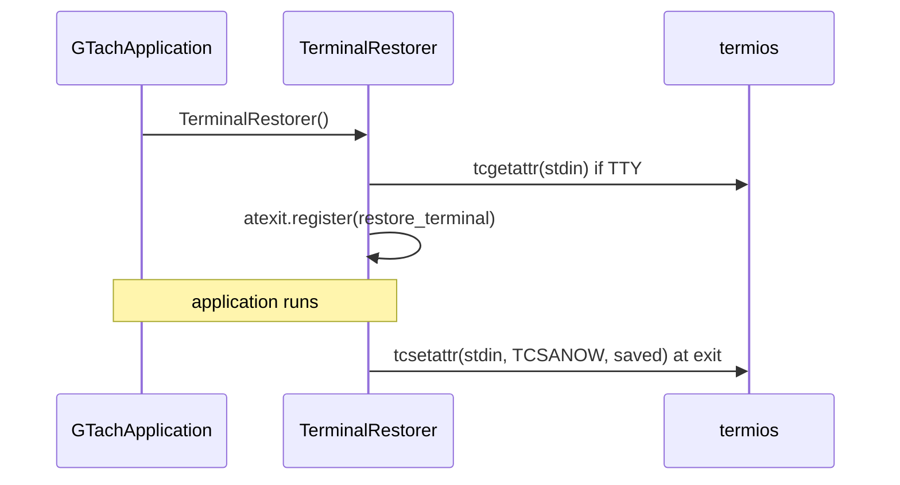

# Component Design: TerminalRestorer

Created: 2025-12-29

## Table of Contents

- [1.0 Document Information](#10-document-information)
- [2.0 Component Overview](#20-component-overview)
- [3.0 Interface](#30-interface)
- [4.0 Error Handling](#40-error-handling)
- [5.0 Visual Documentation](#50-visual-documentation)
- [6.0 Related Documents](#60-related-documents)
- [Version History](#version-history)

---

## 1.0 Document Information

```yaml
document_info:
  document_id: "design-d6e7f8a9-component_utils_terminal_restorer"
  tier: 3
  domain: "Utilities"
  component: "TerminalRestorer"
  parent: "design-9a1f3c7e-domain_utils.md"
  source_file: "src/gtach/utils/terminal.py"
  version: "2.0"
  date: "2026-11-13"
  author: "William Watson"
  status: "Implemented"
```

- **Domain design:** [design-9a1f3c7e-domain_utils.md](design-9a1f3c7e-domain_utils.md)

[Return to Table of Contents](#table-of-contents)

---

## 2.0 Component Overview

`TerminalRestorer` saves the terminal attributes of standard input at construction and restores them at exit, so that a manual run from a terminal leaves the terminal usable. Under systemd, standard input is not a terminal and the component does nothing.

[Return to Table of Contents](#table-of-contents)

---

## 3.0 Interface

```python
class TerminalRestorer:
    def __init__(self) -> None: ...
    def restore_terminal(self) -> None: ...
```

- **Construction:** if `sys.stdin` exists, has a file descriptor and is a TTY, the attributes are saved with `termios.tcgetattr`. A missing or closed standard input is tolerated (issue-042dd7ff). `restore_terminal` is registered with `atexit`.
- **`restore_terminal()`:** if attributes were saved and standard input is still a TTY, restores them with `termios.tcsetattr(..., TCSANOW, ...)`. It is safe to call more than once.

`GTachApplication` creates one instance and passes it to `DisplayManager`.

[Return to Table of Contents](#table-of-contents)

---

## 4.0 Error Handling

| Condition | Handling |
|---|---|
| Saving fails | WARNING; nothing is saved, so nothing is restored |
| Restoring fails | ERROR with traceback |

Logger: `TerminalRestorer`.

[Return to Table of Contents](#table-of-contents)

---

## 5.0 Visual Documentation

Purpose: lifecycle of the saved attributes. Legend: solid arrows are calls.



[Return to Table of Contents](#table-of-contents)

---

## 6.0 Related Documents

- Tests: `tests/test_lifecycle_logging_utils.py`

[Return to Table of Contents](#table-of-contents)

---

## Version History

| Version | Date | Description |
|---|---|---|
| 1.0 | 2025-12-29 | Initial component design document |
| 2.0 | 2026-11-13 | Rewritten against the source: tolerant handling of a missing or closed standard input, `atexit` registration; links converted to GitHub slugs (proposal-f8d0064b WP4). |

---

Copyright (c) 2026 William Watson. MIT License.
