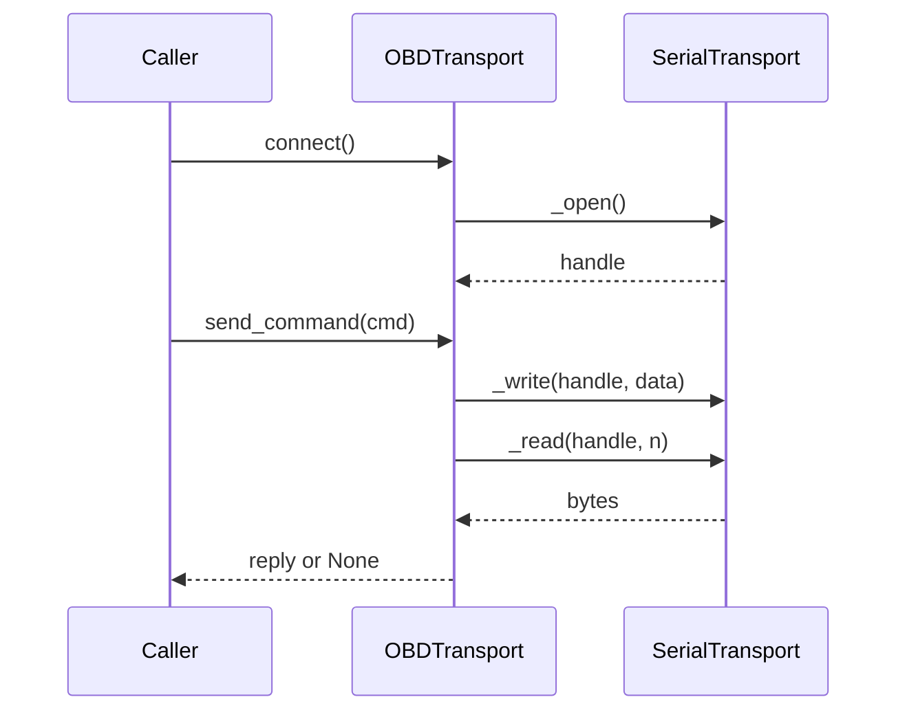

# Component Design: SerialTransport

Created: 2026 March 24

## Table of Contents

- [1.0 Document Information](#10-document-information)
- [2.0 Component Overview](#20-component-overview)
- [3.0 Interface](#30-interface)
- [4.0 Handle Primitives](#40-handle-primitives)
- [5.0 Error Handling](#50-error-handling)
- [6.0 Visual Documentation](#60-visual-documentation)
- [7.0 Related Documents](#70-related-documents)
- [Version History](#version-history)

---

## 1.0 Document Information

```yaml
document_info:
  document_id: "design-e4f5a6b7-component_comm_serial_transport"
  tier: 3
  domain: "Communication"
  component: "SerialTransport"
  parent: "design-7d3e9f5a-domain_comm.md"
  source_file: "src/gtach/comm/serial_transport.py"
  version: "2.0"
  date: "2026-11-13"
  author: "William Watson"
  status: "Implemented"
```

- **Domain design:** [design-7d3e9f5a-domain_comm.md](design-7d3e9f5a-domain_comm.md)
- **Base class:** [design-b1c2d3e4-component_comm_transport.md](design-b1c2d3e4-component_comm_transport.md)

[Return to Table of Contents](#table-of-contents)

---

## 2.0 Component Overview

`SerialTransport` connects to an ELM327 adapter on a serial device (USB or UART) with pyserial. It is selected with `--transport serial [--serial-port PATH]` and is a forced transport. When no port is given, it discovers one.

[Return to Table of Contents](#table-of-contents)

---

## 3.0 Interface

```python
class SerialTransport(OBDTransport):
    _IO_ERRORS = (serial.SerialException, OSError)
    _TIMEOUT_ERRORS = ()
    _EMPTY_READ_IS_EOF = False

    def __init__(self, port: Optional[str] = None, baudrate: int = 38400, retry_delay: float = 5.0): ...
```

- pyserial reports a timeout by returning `b""`, not by raising, so `_TIMEOUT_ERRORS` is empty and an empty read is not an EOF. With nothing buffered, the base class counts it as a timeout (issue-907de6de).
- A raw `OSError` (for example `EIO` on unplug) is a link loss (audit A02).

[Return to Table of Contents](#table-of-contents)

---

## 4.0 Handle Primitives

| Primitive | Implementation |
|---|---|
| `_open()` | Uses the given port or `_discover_port()`; returns `None` when no port is found; otherwise `serial.Serial(port, baudrate, timeout=2)` |
| `_close(handle)` | Closes the port if open |
| `_write(handle, data)` | `handle.write(data)` |
| `_read(handle, n)` | `handle.read_until(b">")`; `n` is unused |
| `_set_timeout(handle, t)` | `handle.timeout = t` |
| `_discard_input(handle)` | `reset_input_buffer()` when `in_waiting` is non-zero; returns the byte count |
| `_describe()` | `"serial device <port> at <baud> baud"` |

### 4.1 Port discovery

`_discover_port()` iterates `serial.tools.list_ports.comports()`. A port whose device name or description contains `ELM`, `OBD` or `OBDII` (case-insensitive) is probed with `_probe_port()`: open, send `ATZ`, read to `>`, and accept when the reply contains `ELM327`. The first port that passes is used.

[Return to Table of Contents](#table-of-contents)

---

## 5.0 Error Handling

All command handling is in `OBDTransport`. `_probe_port()` catches every exception, logs at DEBUG and returns `False`; the probe port is always closed.

[Return to Table of Contents](#table-of-contents)

---

## 6.0 Visual Documentation

Purpose: the division of work between the base class and `SerialTransport`. Legend: solid arrows are calls.



[Return to Table of Contents](#table-of-contents)

---

## 7.0 Related Documents

- [design-b1c2d3e4-component_comm_transport.md](design-b1c2d3e4-component_comm_transport.md)
- Tests: `tests/test_comm_layer_defects.py`, `tests/test_response_alignment.py`

[Return to Table of Contents](#table-of-contents)

---

## Version History

| Version | Date | Description |
|---|---|---|
| 1.0 | 2026-03-24 | Initial component design |
| 2.0 | 2026-11-13 | Rewritten against the source: status corrected (the module exists); the class supplies handle primitives only, the skeleton is in `OBDTransport`; links converted to GitHub slugs (proposal-f8d0064b WP4). |

---

Copyright (c) 2026 William Watson. MIT License.
