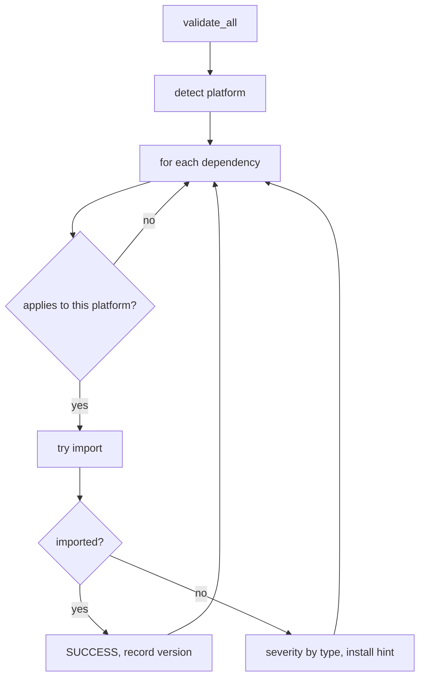

# Component Design: DependencyValidator

Created: 2025-12-29

## Table of Contents

- [1.0 Document Information](#10-document-information)
- [2.0 Component Overview](#20-component-overview)
- [3.0 Elements](#30-elements)
- [4.0 Behaviour](#40-behaviour)
- [5.0 Error Handling](#50-error-handling)
- [6.0 Visual Documentation](#60-visual-documentation)
- [7.0 Related Documents](#70-related-documents)
- [Version History](#version-history)

---

## 1.0 Document Information

```yaml
document_info:
  document_id: "design-e7f8a9b0-component_utils_dependency_validator"
  tier: 3
  domain: "Utilities"
  component: "DependencyValidator"
  parent: "design-9a1f3c7e-domain_utils.md"
  source_file: "src/gtach/utils/dependencies.py"
  version: "2.0"
  date: "2026-11-13"
  author: "William Watson"
  status: "Implemented"
```

- **Domain design:** [design-9a1f3c7e-domain_utils.md](design-9a1f3c7e-domain_utils.md)

[Return to Table of Contents](#table-of-contents)

---

## 2.0 Component Overview

`DependencyValidator` checks that the modules GTach imports are available on the current platform and reports what is missing, with an install hint. It runs for `gtach --validate-dependencies`, which prints the report and exits.

[Return to Table of Contents](#table-of-contents)

---

## 3.0 Elements

```python
class DependencyType(Enum):  REQUIRED, OPTIONAL, PLATFORM_SPECIFIC, DEVELOPMENT
class ValidationResult(Enum):  SUCCESS, WARNING, ERROR, FATAL

@dataclass
class DependencyInfo:
    name: str
    import_name: str
    dependency_type: DependencyType
    platforms: List[str] = []
    version_check: Optional[...] = None
    install_hint: str = ""
    description: str = ""
    alternatives: List[str] = []

@dataclass
class ValidationReport:
    name: str
    dependency_info: DependencyInfo
    result: ValidationResult
    available: bool
    version: Optional[str] = None
    error_message: Optional[str] = None
    install_command: Optional[str] = None

class DependencyValidator:
    def __init__(self, debug: bool = False): ...
    def validate_all(self) -> List[ValidationReport]: ...
    def get_summary(self) -> Dict[str, Any]: ...
    def print_report(self, show_successful: Optional[bool] = None) -> None: ...
    def get_install_commands(self) -> List[str]: ...
    def can_start_application(self) -> bool: ...

def validate_dependencies(debug: bool = False) -> DependencyValidator: ...
```

[Return to Table of Contents](#table-of-contents)

---

## 4.0 Behaviour

### 4.1 Checked dependencies

| Dependency | Import | Type |
|---|---|---|
| Python standard library (`os`, `math`, `threading`, `time`, `logging`) | — | required |
| PyGame | `pygame` | required |
| PyYAML | `yaml` | required |
| PySerial | `serial` | required |
| psutil | `psutil` | required |
| RPi.GPIO | `RPi.GPIO` | platform-specific (Raspberry Pi) |
| HyperPixel2R | `hyperpixel2r` | platform-specific (Raspberry Pi) |

### 4.2 Validation

- The platform is taken from `PlatformDetector` (`is_raspberry_pi()`), with an inline check of `/proc/cpuinfo` as a fallback, so that the validator and the application agree.
- A platform-specific dependency is checked only on its platform.
- Each dependency is imported; the result is `SUCCESS`, or a severity that depends on its type. A missing required dependency is `FATAL`.
- `can_start_application()` is true when no report is `FATAL`.
- The report also states whether the interpreter runs in a virtual environment.

[Return to Table of Contents](#table-of-contents)

---

## 5.0 Error Handling

An import failure is recorded in the `ValidationReport` (`error_message`, `install_command`) and never propagates. Logger: `DependencyValidator`.

[Return to Table of Contents](#table-of-contents)

---

## 6.0 Visual Documentation

Purpose: the validation flow. Legend: rectangles are steps, diamonds are decisions.



[Return to Table of Contents](#table-of-contents)

---

## 7.0 Related Documents

- [design-c5d6e7f8-component_utils_platform_detector.md](design-c5d6e7f8-component_utils_platform_detector.md)
- Tests: `tests/test_lifecycle_logging_utils.py`, `tests/test_platform_detection.py`

[Return to Table of Contents](#table-of-contents)

---

## Version History

| Version | Date | Description |
|---|---|---|
| 1.0 | 2025-12-29 | Initial component design document |
| 2.0 | 2026-11-13 | Rewritten against the source: current dependency list (pygame, PyYAML, pyserial, psutil; RPi.GPIO and hyperpixel2r on the Pi), platform taken from `PlatformDetector`; links converted to GitHub slugs (proposal-f8d0064b WP4). |

---

Copyright (c) 2026 William Watson. MIT License.
