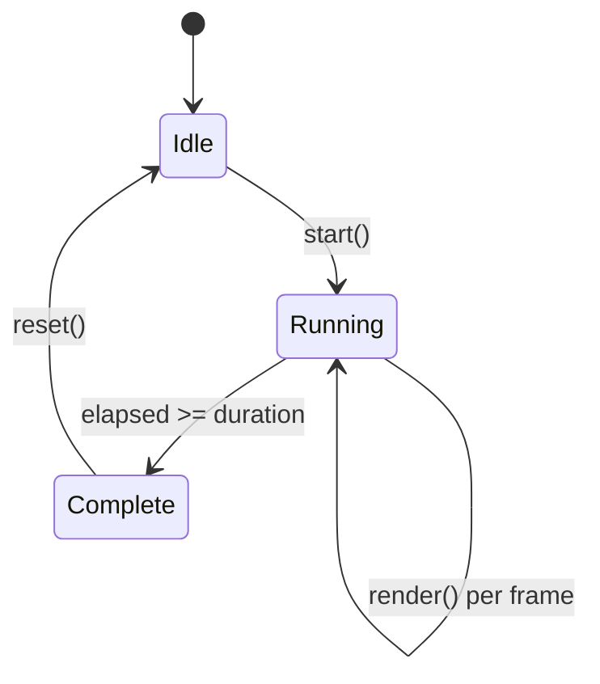

# Component Design: SplashScreen

Created: 2025-12-29

## Table of Contents

- [1.0 Document Information](#10-document-information)
- [2.0 Component Overview](#20-component-overview)
- [3.0 Interface](#30-interface)
- [4.0 Behaviour](#40-behaviour)
- [5.0 Error Handling](#50-error-handling)
- [6.0 Visual Documentation](#60-visual-documentation)
- [7.0 Related Documents](#70-related-documents)
- [Version History](#version-history)

---

## 1.0 Document Information

```yaml
document_info:
  document_id: "design-f2a3b4c5-component_display_splash_screen"
  tier: 3
  domain: "Display"
  component: "SplashScreen"
  parent: "design-2c6b8e4d-domain_display.md"
  source_files:
    - "src/gtach/display/splash.py"
    - "src/gtach/display/graphics/splash_graphics.py"
  version: "2.0"
  date: "2026-11-13"
  author: "William Watson"
  status: "Implemented"
```

- **Domain design:** [design-2c6b8e4d-domain_display.md](design-2c6b8e4d-domain_display.md)

[Return to Table of Contents](#table-of-contents)

---

## 2.0 Component Overview

`SplashScreen` draws the start-up screen: the application title, the version, and a progress indication, for a fixed duration. `DisplayManager` shows it in `DisplayMode.SPLASH` while the transport and the OBD protocol start in the background, and leaves the mode when `is_complete()` is true.

A separate static image is shown by the systemd unit `gtach-boot-splash.service` before the application starts; it is not part of this component.

[Return to Table of Contents](#table-of-contents)

---

## 3.0 Interface

```python
class SplashScreen:
    _TITLE_FONT_SIZE = 72
    _VERSION_FONT_SIZE = 40

    def __init__(self, surface_size: Tuple[int, int] = (480, 480), duration: float = 5.0,
                 config: Optional[SplashConfig] = None): ...
    def start(self) -> None: ...
    def reset(self) -> None: ...
    def is_complete(self) -> bool: ...
    def wait_for_completion(self, timeout: Optional[float] = None) -> bool: ...
    def render(self, surface: pygame.Surface) -> bool: ...
    def get_progress(self) -> float: ...
    def get_remaining_time(self) -> float: ...
    def set_custom_text(self, title=None, subtitle=None, version=None) -> None: ...
    def get_info(self) -> dict: ...
```

- `DisplayManager` constructs it with `duration=4.0`. `SplashConfig` (`utils/config.py`) carries `enabled`, `duration`, `graphics_mode` (`automotive`, `minimal`, `text_only`) and `animation_speed`.
- `surface_size` must be a pair of positive numbers; otherwise `ValueError`.

[Return to Table of Contents](#table-of-contents)

---

## 4.0 Behaviour

- `start()` records the start time with `time.monotonic()`; it is idempotent. `reset()` returns to the initial state.
- `get_progress()` is the elapsed fraction of the duration, from 0.0 to 1.0; `is_complete()` is true at 1.0.
- `render(surface)` draws the background graphics (`draw_automotive_gauge()` from `splash_graphics.py` in the automotive mode), the title, the subtitle, the progress indicator and the version. It returns `False` when nothing could be drawn. Fonts are cached. A check that the text fits the circular viewport runs once and logs its result.
- If the graphics fail, a text-only fallback is drawn.
- State is guarded by an internal lock; `render` is called on the display thread.

[Return to Table of Contents](#table-of-contents)

---

## 5.0 Error Handling

| Condition | Handling |
|---|---|
| Invalid constructor arguments | `ValueError` |
| pygame unavailable | `render` returns `False` |
| Graphics error | Text-only fallback; ERROR |

If `DisplayManager` cannot create or render the splash screen, it enters the post-splash mode at once. Logger: `SplashScreen`.

[Return to Table of Contents](#table-of-contents)

---

## 6.0 Visual Documentation

Purpose: lifecycle of the splash screen. Legend: transitions are labelled with the call or condition.



[Return to Table of Contents](#table-of-contents)

---

## 7.0 Related Documents

- [design-b8c9d0e1-component_display_manager.md](design-b8c9d0e1-component_display_manager.md)
- Tests: `tests/test_monotonic_durations.py`, `tests/test_medium_defects.py`

[Return to Table of Contents](#table-of-contents)

---

## Version History

| Version | Date | Description |
|---|---|---|
| 1.0 | 2025-12-29 | Initial component design document |
| 2.0 | 2026-11-13 | Rewritten against the source: monotonic timing, graphics modes from `SplashConfig`, fit check, fallback; links converted to GitHub slugs (proposal-f8d0064b WP4). |

---

Copyright (c) 2026 William Watson. MIT License.
