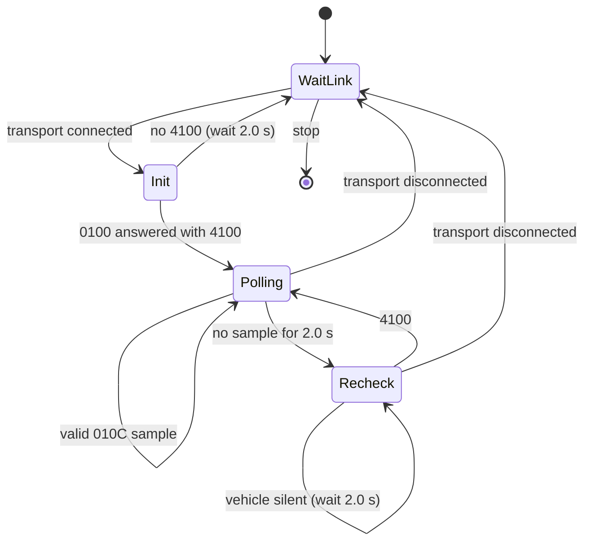

# Component Design: OBDProtocol

Created: 2026 March 24

## Table of Contents

- [1.0 Document Information](#10-document-information)
- [2.0 Component Overview](#20-component-overview)
- [3.0 Elements](#30-elements)
- [4.0 Behaviour](#40-behaviour)
- [5.0 Vehicle Silent State](#50-vehicle-silent-state)
- [6.0 Error Handling](#60-error-handling)
- [7.0 Visual Documentation](#70-visual-documentation)
- [8.0 Related Documents](#80-related-documents)
- [Version History](#version-history)

---

## 1.0 Document Information

```yaml
document_info:
  document_id: "design-f5a6b7c8-component_comm_obd_protocol"
  tier: 3
  domain: "Communication"
  component: "OBDProtocol"
  parent: "design-7d3e9f5a-domain_comm.md"
  source_file: "src/gtach/comm/obd.py"
  version: "2.0"
  date: "2026-11-13"
  author: "William Watson"
  status: "Implemented"
  supersedes: "design-e5f6a7b8-component_comm_obd_protocol (closed)"
```

- **Domain design:** [design-7d3e9f5a-domain_comm.md](design-7d3e9f5a-domain_comm.md)

[Return to Table of Contents](#table-of-contents)

---

## 2.0 Component Overview

`OBDProtocol` initialises an ELM327 adapter over an `OBDTransport`, polls engine speed (mode 01, PID 0C) on its own thread, and delivers samples to the display through `ThreadManager.message_queue`.

Responsibilities:

1. Initialise the adapter (`ATZ`, `ATE0`, `ATL0`, `ATS0`, `ATSP0`) and confirm that the vehicle answers `0100`.
2. Poll `010C` at `poll_interval_s` and queue each valid sample as an `OBDResponse`.
3. Record evidence of a silent vehicle (adapter answering, vehicle not) for the display's "Engine off" state.
4. Report liveness to `ThreadManager` under the name `obd_protocol`.

The protocol never connects or disconnects the transport; `OBDTransport.reconnect_indefinitely()` on the `transport` thread does that. The protocol loop waits while the transport is disconnected and re-initialises after each reconnect.

[Return to Table of Contents](#table-of-contents)

---

## 3.0 Elements

### 3.1 OBDResponse

```python
@dataclass
class OBDResponse:
    pid: int            # 0x0C
    data: bytes         # the two data bytes A, B
    timestamp: float    # time.time() at decode
    error: Optional[str] = None
```

RPM is `((A * 256) + B) / 4`; the display performs the calculation.

### 3.2 OBDProtocol

```python
class OBDProtocol:
    _INIT_RETRY_DELAY_S: float = 2.0
    _INIT_0100_TIMEOUT_S: float = 5.0
    _PRE_INIT_SETTLE_S: float = 1.5
    _SETTLE_SLICE_S: float = 0.5
    _NO_VEHICLE_LOG_INTERVAL_S: float = 60.0
    _RPM_SILENT_RECHECK_S: float = 2.0

    def __init__(self, transport: OBDTransport, thread_manager: ThreadManager,
                 poll_interval_s: float = 0.05, adapter_pre_initialised: bool = False): ...
    def start(self) -> None: ...
    def stop(self, timeout: float = 5.0) -> None: ...
    def last_vehicle_silent_ts(self) -> Optional[float]: ...
```

- The constructor creates the thread `OBDProtocol` and registers it with `ThreadManager` as `obd_protocol`, with `_signal_stop` as its stop function. The stop function signals without joining, so `ThreadManager.stop_thread`'s timeout bounds the stop.
- `adapter_pre_initialised=True` is passed after setup, whose probe has already reset the adapter; `ATZ` is then skipped once.
- `stop(timeout=0)` signals and returns without waiting.
- The command timeout is 1.0 s (`self.timeout`), except `ATZ` (5.0 s) and `0100` (`_INIT_0100_TIMEOUT_S`).

[Return to Table of Contents](#table-of-contents)

---

## 4.0 Behaviour

### 4.1 Protocol loop

```text
while not stopped:
    heartbeat
    if transport not connected: clear silent timestamp; sleep 0.1 s; continue
    if not _initialize_protocol(): heartbeat; wait _INIT_RETRY_DELAY_S; continue
    while transport connected and not stopped:
        heartbeat
        sample = _request_rpm()
        if sample: clear silent timestamp; queue sample; set data_available
        elif no sample for _RPM_SILENT_RECHECK_S: _recheck_vehicle() (leave the loop if it returns False)
        sleep poll_interval_s
    adapter-initialised flag reset; silent timestamp cleared
```

- When the queue is full, the oldest sample is discarded and the newest inserted.
- An unexpected exception in the loop is logged with traceback, followed by a 1.0 s sleep.

### 4.2 Initialisation

1. Not pre-initialised: `ATZ` (5.0 s timeout). Pre-initialised: no `ATZ`; settle `_PRE_INIT_SETTLE_S` in slices of `_SETTLE_SLICE_S`, with a heartbeat after each slice and an early exit on stop (issue-04c18cda).
2. `ATE0`, `ATL0`, `ATS0`, `ATSP0` (always).
3. `0100` with `_INIT_0100_TIMEOUT_S`. After `ATSP0` the adapter searches for the vehicle protocol before answering, which can take several seconds (issue-dc52c4e4).
4. The reply is classified by §5.0. Only a reply containing `4100` completes initialisation.

One heartbeat is sent per command, so that the heartbeat gap is bounded by one command timeout plus the transport's 1.0 s margin (issue-860fd5f7).

### 4.3 RPM request

`_request_rpm()` sends `010C`. A reply is decoded only when it starts with `41`, yields at least four bytes after removal of non-hex characters, and is a mode 01 reply for PID 0C (`41 0C A B`) (issue-907de6de). Any other reply yields no sample.

[Return to Table of Contents](#table-of-contents)

---

## 5.0 Vehicle Silent State

The adapter is connected and answering, but the vehicle is not (normally ignition off). The protocol records this as evidence for the display's "Engine off" state ([design-b8c9d0e1](design-b8c9d0e1-component_display_manager.md)). Source: issue-b29cbd71.

### 5.1 Evidence rule

| `0100` outcome | Classification | Effect |
|---|---|---|
| Reply containing `4100` | Vehicle answering | Clear the silent timestamp; start or resume RPM polling |
| Reply from the adapter without `4100` (`NO DATA`, `UNABLE TO CONNECT`, `BUS INIT: ...ERROR`, `CAN ERROR`, `?`, `7F ...`) | Vehicle silent | Set the silent timestamp to `time.monotonic()`; log per §6.0 |
| No reply (timeout), transport connected | Unknown | Log per §6.0; do not set the silent timestamp |
| No reply, transport disconnected | Link lost | Clear the silent timestamp (issue-146491ba) |

A timeout is never evidence of a silent vehicle: an adapter that has lost power without closing its socket also produces timeouts.

### 5.2 Interface

`last_vehicle_silent_ts()` returns the monotonic time of the latest adapter reply that showed a silent vehicle, or `None` if the vehicle last answered, the transport has disconnected, or no such reply has been seen. It is a single attribute read and is safe from any thread. The timestamp is cleared by a `4100` reply, by a valid `010C` sample, and when the protocol loop sees the transport disconnected.

### 5.3 Silence during polling

If `010C` produces no valid sample for `_RPM_SILENT_RECHECK_S` (2.0 s) while the transport is connected, `_recheck_vehicle()` sends `0100` (timeout `_INIT_0100_TIMEOUT_S`), classified by §5.1. The re-check sends no `ATZ`, applies no settle delay and repeats no configuration command; the adapter has not been reset. While the vehicle stays silent, the re-check repeats after `_INIT_RETRY_DELAY_S`. On a `4100` reply, polling resumes.

An engine that stalls with the ignition on is expected to keep answering `010C` with 0 RPM. That is a valid sample and does not enter this path (inference; to be confirmed in the in-car test).

[Return to Table of Contents](#table-of-contents)

---

## 6.0 Error Handling

| Condition | Handling |
|---|---|
| Transport not connected | The loop waits; `_send_command` returns `None` |
| `0100` without `4100` | WARNING `Vehicle not answering: no valid 0100 response (...)`, at most once per `_NO_VEHICLE_LOG_INTERVAL_S` (audit A05); retry after `_INIT_RETRY_DELAY_S` |
| Link lost during initialisation | DEBUG; initialisation fails; not treated as a silent vehicle |
| Malformed or foreign reply to `010C` | No sample; no log record |
| Exception in a command, in initialisation or in the loop | ERROR with traceback; the loop continues |

Logger: `OBDProtocol`.

[Return to Table of Contents](#table-of-contents)

---

## 7.0 Visual Documentation

Purpose: the states of the protocol loop. Legend: transitions are labelled with the event that causes them.



[Return to Table of Contents](#table-of-contents)

---

## 8.0 Related Documents

- [design-b1c2d3e4-component_comm_transport.md](design-b1c2d3e4-component_comm_transport.md)
- [design-b8c9d0e1-component_display_manager.md](design-b8c9d0e1-component_display_manager.md) (consumer of samples and of the silent timestamp)
- `closed/design-e5f6a7b8-component_comm_obd_protocol.md` (superseded; its §6.3 is §5.0 here)
- Tests: `tests/test_engine_off_state.py`, `tests/test_obd_settle.py`, `tests/test_response_alignment.py`, `tests/test_comm_layer_defects.py`, `tests/test_medium_defects.py`

[Return to Table of Contents](#table-of-contents)

---

## Version History

| Version | Date | Description |
|---|---|---|
| 1.0 | 2026-03-24 | Initial component design; transport abstraction replaces BluetoothManager |
| 2.0 | 2026-11-13 | Merged design-e5f6a7b8 (vehicle silent state, its §6.3) into this document and retired it; rewritten against the source: status corrected, class constants, loop, initialisation with the pre-initialised path, PID check; links converted to GitHub slugs (proposal-f8d0064b WP4). |

---

Copyright (c) 2026 William Watson. MIT License.
