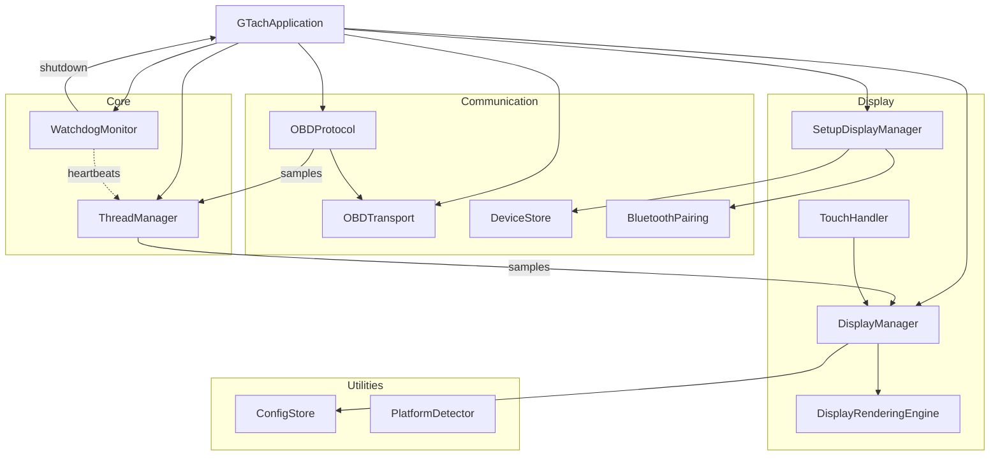
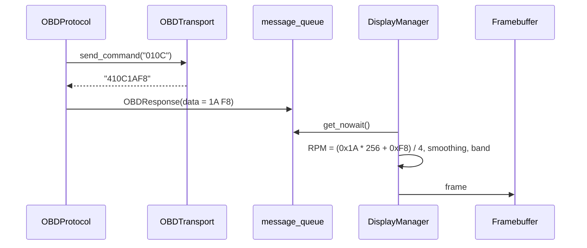

# Master Design: GTach

Created: 2025-12-29

## Table of Contents

- [1.0 Project Information](#10-project-information)
- [2.0 Scope](#20-scope)
- [3.0 System Overview](#30-system-overview)
- [4.0 Design Constraints](#40-design-constraints)
- [5.0 Development Environment and Target Platform](#50-development-environment-and-target-platform)
- [6.0 Architecture](#60-architecture)
- [7.0 Application Controller](#70-application-controller)
- [8.0 Domain Structure](#80-domain-structure)
- [9.0 Data Design](#90-data-design)
- [10.0 Interfaces](#100-interfaces)
- [11.0 Error Handling](#110-error-handling)
- [12.0 Non-Functional Requirements](#120-non-functional-requirements)
- [13.0 Visual Documentation](#130-visual-documentation)
- [14.0 Design Documents](#140-design-documents)
- [Version History](#version-history)

---

## 1.0 Project Information

```yaml
project_info:
  name: "GTach"
  document: "design-gtach-master (Tier 1 master design)"
  version: "3.0"
  date: "2026-11-13"
  author: "William Watson"
  description: "Real-time engine tachometer for a Raspberry Pi with a round touch display and an ELM327 OBD-II adapter"
  license: "MIT"
  requirements: "ai/workspace/requirements/requirements-gtach-master.md"
```

This is the master design. It describes the system as implemented in `src/gtach/`; the package version is set in `pyproject.toml`.

[Return to Table of Contents](#table-of-contents)

---

## 2.0 Scope

### 2.1 In scope

- Engine speed display from OBD-II (mode 01, PID 0C) on a 480×480 round panel.
- Connection to an ELM327 adapter over Classic Bluetooth (RFCOMM); TCP, serial and simulated transports for development and bench tests.
- On-device setup: discovery, pairing and verification of the adapter.
- Link supervision with indefinite reconnection and a named failure cause.
- Operation as a systemd service with watchdog-initiated restart.
- On-device update from a staged wheel, with rollback.

### 2.2 Out of scope

- Other OBD-II parameters, diagnostic trouble codes, data logging.
- Bluetooth Low Energy adapters.
- Runtime targets other than Linux on a Raspberry Pi. macOS is a build and development host only.
- Acting on the host to recover a Bluetooth fault (adapter reset, service restart); see `ai/task.md`.

### 2.3 Terminology

| Term | Meaning |
|---|---|
| ELM327 | OBD-II adapter with an AT command interface |
| RFCOMM / SPP | Classic Bluetooth serial port emulation |
| Transport | The byte link to the adapter (`OBDTransport`) |
| `GTACH_HOME` | Runtime directory; default `/opt/gtach` |
| DISCONNECTED, Engine off | Screens derived from link state, not display modes |

[Return to Table of Contents](#table-of-contents)

---

## 3.0 System Overview

GTach polls engine speed from the vehicle through an ELM327 adapter and draws a radial gauge.


Primary functions:

1. Start, show the splash screen, and enter setup when no adapter is paired.
2. Connect, initialise the adapter, poll RPM, and draw the gauge with colour bands from the engine profile.
3. Show DISCONNECTED with the failure cause while the link is down, and "Engine off" while the adapter answers and the vehicle does not.
4. Offer OPTIONS: clear settings, check for updates, simulation mode, debug logging.
5. Recover from a stalled critical thread by process restart.

[Return to Table of Contents](#table-of-contents)

---

## 4.0 Design Constraints

| Constraint | Value |
|---|---|
| Runtime | Python 3.9 or newer; Debian 11 (Bullseye) 64-bit on a Raspberry Pi Zero 2W (512 MB RAM) |
| Display | 480×480 round panel; viewport radius 238 px; framebuffer output, no window system |
| Concurrency | Standard-library `threading`; shared state behind locks; no call-out under a lock; no async framework |
| Time | `time.monotonic()` for every interval and timeout |
| Hardware libraries | `RPi.GPIO`, `hyperpixel2r` imported conditionally (`.[pi]` extra) |
| Configuration | One flat `config.yaml` under `GTACH_HOME` |
| Host actions | Only the operator-initiated reboot (`/sbin/reboot`) and the staged-update marker; no Bluetooth host actions |

Performance targets:

| Metric | Target |
|---|---|
| Display frame rate | 30 frames per second (`fps_limit`) |
| RPM poll interval | 0.05 s (0.02 s on TCP and simulated transports) |
| Reconnection | Indefinite; 5.0 s between attempts |
| Dead-link detection | 5 consecutive command timeouts, or 2.0 s without a sample at the display |
| Watchdog | Warning at 15 s, soft recovery at 30 s, shutdown of a critical thread at 45 s |
| Exit backstop | 20 s, then forced exit |

[Return to Table of Contents](#table-of-contents)

---

## 5.0 Development Environment and Target Platform

| Item | Development host | Target |
|---|---|---|
| Hardware | Mac Mini (Apple Silicon); builds and deploys | Raspberry Pi Zero 2W, HyperPixel 2.1 Round, ELM327 (Bluetooth SPP) |
| Python | venv `venv/`; `pip install -e .[dev]` | venv `/opt/gtach/venv`; wheel with the `.[pi]` extra |
| Tools | pytest, mypy (3.9 target), black, isort, flake8 | systemd units `gtach.service`, `gtach-boot-splash.service`, `hyperpixel2r-init.service` |
| Test transports | `simbt`, `simtcp`, `tcp` (ELM327 emulator) | `rfcomm` |

Deployment: `bin/deploy.sh` builds the wheel, copies it and the service files to the Pi and runs `bin/install.sh`; `bin/pi-install.sh` installs a release from GitHub. `gtach.service` runs `/opt/gtach/venv/bin/gtach` as root with `Restart=always`; `gtach-preflight.sh` (ExecStartPre) installs a staged wheel and rolls back an update that fails to start twice.

[Return to Table of Contents](#table-of-contents)

---

## 6.0 Architecture

### 6.1 Pattern

A layered, threaded application. `GTachApplication` (`app.py`) constructs and wires the components; components interact through `ThreadManager` (queue, heartbeats) and through callbacks injected by the application, not through direct references to each other.

### 6.2 Threads

| Thread | Component | Watchdog class |
|---|---|---|
| main | `GTachApplication.run()` wait loop; signal handlers | not monitored |
| `display` | `DisplayManager._display_loop` | critical |
| `obd_protocol` | `OBDProtocol._protocol_loop` | critical |
| `transport` | `OBDTransport.reconnect_indefinitely` | advisory |
| `WatchdogMonitor` | health checks every 5 s | — |
| touch | touch interface callback thread | — |
| workers | `ThreadManager.worker_pool`, setup async operations | — |

### 6.3 Technology stack

| Concern | Implementation |
|---|---|
| Display | pygame (SDL2, `SDL_VIDEODRIVER=dummy`), `/dev/fb0` mmap |
| Bluetooth | Kernel RFCOMM socket (`socket.AF_BLUETOOTH`); `bluetoothctl` for discovery |
| Serial | pyserial |
| Configuration | PyYAML |
| CLI | argparse |
| Logging | `start.log`, `debug.log`, `error.log`, `stacks.log` under `GTACH_HOME` |
| Process metrics | psutil |

### 6.4 Directory structure

```text
src/gtach/
  main.py            entry point, argparse CLI, logging setup
  app.py             GTachApplication: wiring, modes, shutdown
  assets/            engine_profiles.yaml, fonts/
  comm/              transports, OBD protocol, device store, pairing, simulation
  core/              ThreadManager, WatchdogMonitor
  display/           DisplayManager, rendering/, input/, performance/, setup, splash, typography
  utils/             config, home, platform, dependencies, terminal, waits, updater, pi_reset, stack_dump, ack_state
bin/                 build, deploy, install, release and service files
tests/               pytest suite
```

[Return to Table of Contents](#table-of-contents)

---

## 7.0 Application Controller

`GTachApplication` has no Tier 2 document; its design is recorded here.

- **Start:** a forced transport (`tcp`, `serial`, `simtcp`) starts normal mode. `rfcomm` and `simbt` given explicitly always enter setup mode (`simbt` with `SimBluetoothPairing` and its own `devices-sim.yaml`). Without `--transport`, setup mode is entered when the device store has no primary device; otherwise normal mode.
- **Normal mode:** create `DisplayManager`, inject callbacks, start the display (splash), select the transport, create `OBDProtocol`, start the watchdog, start the `transport` thread and the protocol.
- **Setup mode:** create or reuse `DisplayManager`, create `SetupDisplayManager`; on completion `_on_setup_complete()` starts the transport and the protocol once (`adapter_pre_initialised` when the setup session reset the adapter).
- **Re-entering setup** (from DISCONNECTED or Clear settings): stop `transport` and `obd_protocol` (2.0 s each), then setup mode again.
- **Shutdown order:** watchdog, setup manager, async workers, display, transport, protocol, thread manager. Each step is isolated. A 20 s backstop timer forces `os._exit(1)` if the orderly path overruns.
- **Exit status:** 1 after a startup failure, a runtime error or a watchdog exit; 0 after SIGINT, SIGTERM or a requested restart. systemd restarts in every case.
- **Logging control:** start-up records go to `start.log`, which is silenced once start-up completes; `toggle_debug_logging()` switches `debug.log` and fatal-error stack capture at runtime.
- **Update probation:** a healthy start removes `/opt/gtach/.update-probation`.

CLI (`main.py`): `--config PATH`, `--debug`, `--version`, `--validate-config`, `--validate-dependencies`, `--transport {tcp,serial,rfcomm,simtcp,simbt}`, `--obd-host`, `--obd-port`, `--serial-port`. The validation commands log to stderr, open no log file and exit.

[Return to Table of Contents](#table-of-contents)

---

## 8.0 Domain Structure

| Domain | Package | Responsibility | Design |
|---|---|---|---|
| Core | `gtach.core` | Thread registry, heartbeats, sample queue, watchdog | [design-4f8a2b1c](design-4f8a2b1c-domain_core.md) |
| Communication | `gtach.comm` | Transports, link supervision, OBD protocol, device store, pairing | [design-7d3e9f5a](design-7d3e9f5a-domain_comm.md) |
| Display | `gtach.display` | Screens, framebuffer output, touch, setup mode | [design-2c6b8e4d](design-2c6b8e4d-domain_display.md) |
| Utilities | `gtach.utils` | Configuration, home directory, platform, dependencies, host helpers | [design-9a1f3c7e](design-9a1f3c7e-domain_utils.md) |

[Return to Table of Contents](#table-of-contents)

---

## 9.0 Data Design

| Entity | Location | Content |
|---|---|---|
| `AppConfig` | `GTACH_HOME/config.yaml` | `mode`, `palette`, `engine_profile`, `fps_limit`, `touch_long_press`, `rpm_warning`, `rpm_danger` |
| Paired devices | `GTACH_HOME/config/devices.yaml` | `paired_devices.primary`, `paired_devices.secondary` |
| Engine profiles | `gtach/assets/engine_profiles.yaml` (packaged) | Named `RPMBands` threshold sets |
| Acknowledgement state | state file managed by `AcknowledgementStateManager` | Hash of the acknowledged thresholds and profile |
| Update staging | `/opt/gtach/updates/` | Wheels and the `.install-pending` marker |
| `OBDResponse` | in memory | `pid`, `data`, `timestamp` |

Validation: `ConfigStore.load()` replaces invalid values by defaults with a WARNING and never writes; `save()` writes atomically and keeps unknown keys. `DeviceStore` repairs an unexpected file structure in memory and writes atomically.

[Return to Table of Contents](#table-of-contents)

---

## 10.0 Interfaces

### 10.1 Internal

| From | To | Mechanism |
|---|---|---|
| `OBDProtocol` | `DisplayManager` | `ThreadManager.message_queue` (capacity 5), `data_available` |
| `DisplayManager` | transport and protocol | Callbacks injected by `GTachApplication` (link state, cause, retry period, silent-vehicle timestamp) |
| `DisplayManager` | `GTachApplication` | Callbacks (re-enter setup, reset, restart, debug toggle) |
| All threads | `WatchdogMonitor` | Heartbeats in `ThreadManager` |
| `WatchdogMonitor` | `GTachApplication` | `shutdown_callback` |

### 10.2 External

| Interface | Protocol |
|---|---|
| ELM327 adapter | AT commands and OBD-II mode 01 over RFCOMM channel 1 (or TCP, serial) |
| Display | Linux framebuffer `/dev/fb0`, 32-bit |
| Touch | `hyperpixel2r` touch driver |
| systemd | `gtach.service`; exit status; SIGTERM |
| Operator | Touch gestures; `SIGUSR1` for a stack dump |

[Return to Table of Contents](#table-of-contents)

---

## 11.0 Error Handling

- **Strategy:** components log and continue; the transport reconnects indefinitely; a stalled or exited critical thread ends the process and systemd restarts it. No thread is restarted in process.
- **Exceptions:** `TransportError` and its subclasses in the Communication domain; other failures are handled where they occur and logged with `exc_info=True` when unexpected.
- **Logging:**

| File | Content | Rotation |
|---|---|---|
| `start.log` | Start-up records at DEBUG | Truncated at each start |
| `debug.log` | Everything at DEBUG while debug is on | Rotated at start; 10 MB × 10 |
| `error.log` | WARNING and above, always on | 1 MB × 5, by size only |
| `stacks.log` | Fatal-error tracebacks (when armed) and `SIGUSR1` thread dumps | 3 generations |

While debug is off, the root logger level is WARNING after start-up, so DEBUG and INFO calls build no record.

[Return to Table of Contents](#table-of-contents)

---

## 12.0 Non-Functional Requirements

| Area | Design response |
|---|---|
| Performance | Frame budget of 1/30 s; single surface written directly to the framebuffer; no per-frame allocation of metrics |
| Reliability | Watchdog with process restart; exit backstop; atomic file writes; update rollback after two failed starts |
| Safety of presentation | An unknown link state is shown as DISCONNECTED; a stale needle is never shown as live |
| Security | The service runs as root with `NoNewPrivileges`, `PrivateTmp`, `ProtectHome`, `ProtectSystem=full`; the only command executed is the fixed `/sbin/reboot`; no network listener |
| Maintainability | Type hints with mypy strict settings (Python 3.9 target); pytest suite; governance T-Docs per source change |

[Return to Table of Contents](#table-of-contents)

---

## 13.0 Visual Documentation

Purpose: system architecture. Legend: arrows show data or control flow between components; subgraphs are domains.



Purpose: data flow of one RPM sample. Legend: solid arrows are calls or writes, dashed arrows are returns.



The thread status, transport state and screen flow diagrams are in the component documents (design-a1b2c3d4, design-b1c2d3e4, design-b8c9d0e1).

[Return to Table of Contents](#table-of-contents)

---

## 14.0 Design Documents

### 14.1 Tier 2

- [design-4f8a2b1c-domain_core.md](design-4f8a2b1c-domain_core.md)
- [design-7d3e9f5a-domain_comm.md](design-7d3e9f5a-domain_comm.md)
- [design-2c6b8e4d-domain_display.md](design-2c6b8e4d-domain_display.md)
- [design-9a1f3c7e-domain_utils.md](design-9a1f3c7e-domain_utils.md)

### 14.2 Tier 3

| Domain | Documents |
|---|---|
| Core | [a1b2c3d4 ThreadManager](design-a1b2c3d4-component_core_thread_manager.md), [b2c3d4e5 WatchdogMonitor](design-b2c3d4e5-component_core_watchdog_monitor.md) |
| Communication | [b1c2d3e4 OBDTransport](design-b1c2d3e4-component_comm_transport.md), [c2d3e4f5 RFCOMMTransport](design-c2d3e4f5-component_comm_rfcomm_transport.md), [d3e4f5a6 TCPTransport](design-d3e4f5a6-component_comm_tcp_transport.md), [e4f5a6b7 SerialTransport](design-e4f5a6b7-component_comm_serial_transport.md), [f5a6b7c8 OBDProtocol](design-f5a6b7c8-component_comm_obd_protocol.md), [a6b7c8d9 DeviceStore](design-a6b7c8d9-component_comm_device_store.md), [a7b8c9d0 BluetoothDevice](design-a7b8c9d0-component_comm_bluetooth_device.md) |
| Display | [b8c9d0e1 DisplayManager](design-b8c9d0e1-component_display_manager.md), [c9d0e1f2 DisplayRenderingEngine](design-c9d0e1f2-component_display_rendering_engine.md), [d0e1f2a3 TouchEventCoordinator](design-d0e1f2a3-component_display_touch_coordinator.md), [f2a3b4c5 SplashScreen](design-f2a3b4c5-component_display_splash_screen.md), [a3b4c5d6 SetupDisplayManager](design-a3b4c5d6-component_display_setup_manager.md) |
| Utilities | [b4c5d6e7 ConfigStore](design-b4c5d6e7-component_utils_config_manager.md), [f8a9b0c1 gtach_home](design-f8a9b0c1-component_utils_home.md), [c5d6e7f8 PlatformDetector](design-c5d6e7f8-component_utils_platform_detector.md), [d6e7f8a9 TerminalRestorer](design-d6e7f8a9-component_utils_terminal_restorer.md), [e7f8a9b0 DependencyValidator](design-e7f8a9b0-component_utils_dependency_validator.md) |

### 14.3 Retired (in `closed/`)

`design-d4e5f6a7-component_comm_bluetooth_manager`, `design-c3d4e5f6-component_core_async_sync_bridge`, `design-g1h2i3j4-gesture_reference`, `design-e1f2a3b4-component_display_performance_monitor`, `design-f6a7b8c9-component_comm_device_store` (superseded by a6b7c8d9), `design-e5f6a7b8-component_comm_obd_protocol` (merged into f5a6b7c8). Basis: `report-71ab3751-design-review` and `proposal-f8d0064b` §4.5.

[Return to Table of Contents](#table-of-contents)

---

## Version History

| Version | Date | Description |
|---|---|---|
| 1.0 | 2025-12-29 | Initial master design document created via reverse engineering of existing source code |
| 1.1 | 2025-12-29 | Added Tier 2 domain document cross-references (Core, Comm, Display, Utils, Provisioning) |
| 1.2 | 2025-12-29 | Added Tier 3 component document cross-references (23 components across 5 domains) |
| 1.3 | 2026-03-13 | C2: memory 256->128 MB. C3: FPS 60->30. C4: DisplayConfig entity updated to fixed band model. C5: removed Provisioning domain (OOS-11). Error strategy updated: indefinite reconnect, no retry limit. |
| 2.0 | 2026-04-01 | Updated to reflect transport abstraction (change e1f2a3b4 / requirements v0.9): removed Bleak/BluetoothManager; added OBDTransport/RFCOMMTransport/SerialTransport/TCPTransport; updated component relationships, entity definition (BluetoothDevice simplified), interface (OBDTransport replaces BluetoothManager), technology stack, context flow. Corrected display mode flow to include DISCONNECTED state and long-press to setup (REQ f3a4b5c6). Corrected logging to no-output-in-production (NFR e1f2a3b4). Removed session-based logging. Renamed §13.3 to Transport State Machine. |
| 2.1 | 2026-05-27 | §15.3: added gesture reference document cross-reference. |
| 2.2 | 2026-05-27 | Renamed SETTINGS → OPTIONS in §8.3, §9.1.3, §13.4. Added OPTIONS transitions to §13.4 display mode flow. |
| 3.0 | 2026-11-13 | Refreshed against the source: Linux-only runtime, simulated transports, single `config.yaml` under `GTACH_HOME`, four log files, watchdog with process restart, update with rollback, application controller design, current thread table; design document list updated for the retired and merged documents; state diagrams left to the component documents; links converted to GitHub slugs (proposal-f8d0064b WP4). |

---

Copyright (c) 2026 William Watson. MIT License.
